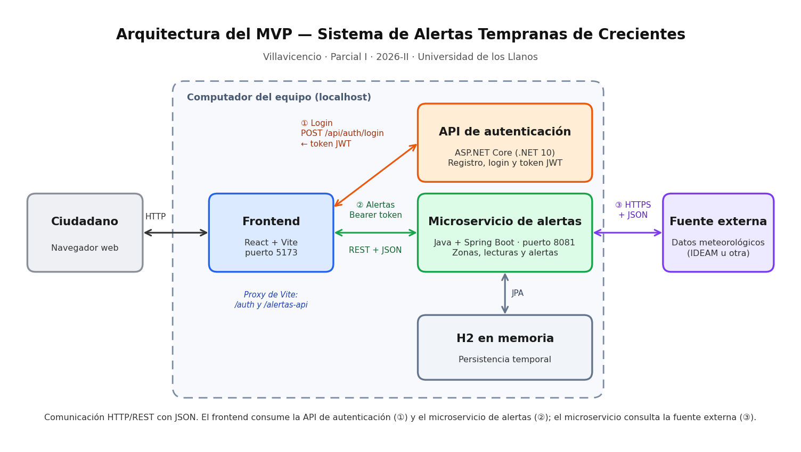

# Sistema de Alertas Tempranas de Crecientes — Villavicencio

* **Asignatura:** Teleco 1 · Proyecto final · 2026-II
* **Institución:** Universidad de los Llanos (FCBI, Ingeniería de Sistemas)

## Integrantes
| # | Integrante | Rol principal |
|---|---|---|
| 1 | Alex Pérez Pedraza | Frontend: Pantalla de login e integración con API de autenticación |
| 2 | Brayan Espitia | Frontend: Vista de alertas y consumo de microservicio |
| 3 | Nicolás Villarraga | Microservicio de alertas: Endpoints, modelo y umbrales |
| 4 | Eduar Murcia | Consumo de datos externos (IDEAM), diagramas y README |


## Diagrama de arquitectura del Proyecto


| Componente | Tecnología | Puerto | Dónde está |
|---|---|---|---|
| Frontend | React + Vite | 5173 | `frontend/` |
| API de autenticación | ASP.NET Core (.NET 10) + EF Core/PostgreSQL | 5132 | `auth-service/` (basada en [mini-identity-api-dotnet](https://github.com/wolfcor10/mini-identity-api-dotnet), con persistencia y CRUD agregados) |
| Microservicio de alertas | Java + Spring Boot, PostgreSQL | 8081 | `alertas-service/` |
 
Toda la comunicación es HTTP/REST con JSON. El navegador solo habla con el frontend (puerto 5173) y el proxy de Vite reenvía las llamadas, así que no hay problemas de CORS en desarrollo:
 
| El navegador llama a | Se reenvía a |
|---|---|
| `/auth-api/...` | `http://localhost:5132/...` |
| `/alertas-api/...` | `http://localhost:8081/...` |
 
Más detalle en `docs/infraestructura.md`, `docs/aplicacion.md` y `docs/modelo-datos.md`.
 
## Estructura del repositorio
 
```
SisAlert/
├── frontend/          React + Vite (login, tablero, alertas, zonas)
├── alertas-service/   Spring Boot (zonas, lecturas, alertas, umbrales, CRUD de zonas)
├── auth-service/      ASP.NET Core (.NET 10) con EF Core (usuarios, roles, permisos)
├── docs/              Diagramas de infraestructura, aplicación y datos
└── README.md
```

Ambos servicios comparten la misma instancia de PostgreSQL (`sisalert`) pero cada uno tiene **su propio esquema**: `alertas` (`zona`, `lectura`, `alerta`, versionado con Flyway) e `identidad` (`usuarios`, `roles`, `permisos` y sus tablas puente, versionado con EF Core). Así se pueden arrancar en cualquier orden y en la nube cada uno puede tener un usuario con permisos solo sobre su esquema.
 
## Requisitos
 
| Herramienta | Versión | Para qué |
|---|---|---|
| Git | reciente | Clonar los repositorios |
| .NET SDK | 10 | API de autenticación |
| JDK | 17 o superior | Microservicio de alertas (Maven va incluido con `mvnw`) |
| Node.js | 20 o superior | Frontend |
| Docker | reciente (opcional) | Contenedor de PostgreSQL (y despliegue con compose) |
 
Comprobar versiones:
 
```bash
git --version
dotnet --version
java -version
node -v
```
 
## Cómo levantar todo
 
Se necesitan **tres terminales**, una por componente, más el contenedor de PostgreSQL. Conviene arrancarlos en este orden.
 
### 1. API de autenticación (terminal 1)

El proyecto ya está integrado en `auth-service/` (no hay que clonar nada aparte). Usa la misma base PostgreSQL que el microservicio de alertas y guarda usuarios, roles y permisos en tablas propias mediante EF Core.

```bash
cd SisAlert/auth-service/src/MiniIdentityApi.Api
dotnet run --launch-profile http
```

Queda escuchando en `http://localhost:5132`. Swagger está en `http://localhost:5132/swagger`.

La cadena de conexión se toma de `ConnectionStrings:Identity` y se puede sobrescribir con la variable de entorno `ConnectionStrings__Identity`:

```powershell
$env:ConnectionStrings__Identity = "Host=localhost;Port=5432;Database=sisalert;Username=sisalert;Password=sisalert"
```

Al arrancar aplica sus migraciones de EF Core y crea el usuario inicial si no existe:

| Usuario | Contraseña | Rol |
|---|---|---|
| `admin` | `Admin123*` | Admin |

Los usuarios registrados desde la pantalla de registro **ya no se pierden** al reiniciar: quedan en PostgreSQL. Las contraseñas se almacenan con hash y sal, nunca en texto plano.
 
### 2. Microservicio de alertas (terminal 2)

El servicio necesita PostgreSQL. La forma más rápida de tenerlo es un contenedor:

```bash
docker run -d --name sisalert-db --restart unless-stopped \
  -e POSTGRES_DB=sisalert -e POSTGRES_USER=sisalert -e POSTGRES_PASSWORD=sisalert \
  -p 5432:5432 -v sisalert-pgdata:/var/lib/postgresql/data postgres:16-alpine
```

Si el contenedor ya existe pero está detenido: `docker start sisalert-db`. Los datos viven en el volumen `sisalert-pgdata` y sobreviven a reinicios del contenedor y del servicio. El esquema lo crea y versiona Flyway al arrancar (`alertas-service/src/main/resources/db/migration`).

La conexión se configura con variables de entorno (los valores por defecto son los del comando anterior):

| Variable | Valor por defecto |
|---|---|
| `DB_URL` | `jdbc:postgresql://localhost:5432/sisalert` |
| `DB_USER` | `sisalert` |
| `DB_PASSWORD` | `sisalert` |

```bash
cd SisAlert/alertas-service
./mvnw spring-boot:run          # Linux / macOS
mvnw.cmd spring-boot:run        # Windows
```

Queda escuchando en `http://localhost:8081`. La primera vez siembra las tres zonas de riesgo; en arranques posteriores conserva zonas, lecturas y alertas. Las zonas empiezan sin lecturas hasta que se sincroniza.

Las pruebas unitarias se corren con `./mvnw test` (en Windows, `mvnw.cmd test`) y usan H2 en memoria, así que no necesitan PostgreSQL.

La fuente de datos se elige en `application.properties` con `alertas.fuente`:

| Valor | Fuente |
|---|---|
| `open-meteo` (por defecto) | Lluvia real en vivo para Villavicencio desde Open-Meteo; necesita internet |
| `ideam` | Datos abiertos del IDEAM en datos.gov.co; el token opcional va en la variable de entorno `ALERTAS_IDEAM_APP_TOKEN` |
| `simulada` | Lluvia aleatoria entre 0 y 90 mm; respaldo para demostrar sin internet |
| `escenario` | Resultados fijos para demostrar con lluvia en época seca; se elige con `alertas.escenario` |

No hace falta editar el archivo: Spring también lee estas propiedades desde variables de entorno (`ALERTAS_FUENTE`, `ALERTAS_ESCENARIO`). Por ejemplo, para la demostración con lluvia:

```powershell
$env:ALERTAS_FUENTE = "escenario"; $env:ALERTAS_ESCENARIO = "tormenta"; .\mvnw.cmd spring-boot:run
```

| `ALERTAS_ESCENARIO` | Resultado al sincronizar |
|---|---|
| `seca` | Todas las zonas en NORMAL |
| `tormenta` (por defecto) | Guatiquía Norte en PRECAUCIÓN, Guayuriba Sur en PELIGRO, Caño Grande Centro en NORMAL |
| `creciente` | Todas las zonas en PELIGRO |

Para volver a los datos reales basta con cerrar esa terminal y arrancar el servicio normal.

Los umbrales de alerta están en el mismo archivo (`alertas.umbral.precaucion-mm` y `alertas.umbral.peligro-mm`) y se cambian sin recompilar.

El microservicio lee el usuario del token solo para registrar en el log quién sincronizó; **no valida la firma** del token en esta etapa (ver `docs/infraestructura.md` §7).
 
### 3. Frontend (terminal 3)
 
```bash
cd SisAlert/frontend
npm install        # solo la primera vez
npm run dev
```
 
Abrir **http://localhost:5173** e iniciar sesión con `admin` / `Admin123*`.

Recorrido de la demostración:

1. **Tablero** (`/estaciones`): una tarjeta por zona. Al arrancar todas aparecen en gris como "Sin datos".
2. Botón **Sincronizar lecturas**: el microservicio consulta la fuente de datos, guarda las lecturas y recalcula el nivel de cada zona (verde, amarillo o rojo).
3. **Alertas** (`/alertas`): solo las zonas en precaución o peligro, la más grave primero.
4. **Zonas** (`/zonas`): crear, editar y eliminar zonas de riesgo. Al eliminar una zona se borran en cascada sus lecturas y alertas.

## Endpoints del microservicio de alertas

| Método | Ruta | Qué hace |
|---|---|---|
| GET | `/api/zonas` | Lista de zonas de riesgo (incluye `codigoEstacion`) |
| GET | `/api/zonas/{id}` | Una zona por id |
| POST | `/api/zonas` | Crea una zona (`nombre`, `cuerpoAgua`, `comunidades`, `codigoEstacion`) |
| PUT | `/api/zonas/{id}` | Actualiza una zona |
| DELETE | `/api/zonas/{id}` | Elimina la zona y, en cascada, sus lecturas y alertas |
| GET | `/api/alertas` | Una entrada por zona con su alerta vigente (`nivel` en `null` si aún no hay lecturas) |
| POST | `/api/lecturas/sincronizar` | Consulta la fuente externa, guarda las lecturas y recalcula las alertas; devuelve lo mismo que `GET /api/alertas` |

Los niveles son `NORMAL`, `PRECAUCION` y `PELIGRO`. Si la fuente externa falla, `sincronizar` responde `502` con `{"error":"FUENTE_EXTERNA_NO_DISPONIBLE","mensaje":"..."}` y no cambia ninguna alerta. Los errores de validación responden `400`, los recursos inexistentes `404` y los duplicados `409`, siempre con `{"error":"CODIGO","mensaje":"texto"}`. El detalle de cada respuesta está en `docs/aplicacion.md` §5.

## Endpoints de la API de identidad

| Método | Ruta | Qué hace |
|---|---|---|
| POST | `/api/auth/register` | Registra un usuario |
| POST | `/api/auth/login` | Valida credenciales y devuelve el JWT |
| GET | `/api/users` | Lista usuarios (solo Admin) |
| GET | `/api/users/{id}` | Consulta un usuario |
| PUT | `/api/users/{id}` | Edita nombre de usuario y correo (solo Admin) |
| DELETE | `/api/users/{id}` | Elimina un usuario; protege al último administrador (solo Admin) |
| PATCH | `/api/users/{id}/activate` \| `/deactivate` | Activa o desactiva un usuario (solo Admin) |
| POST | `/api/users/{id}/roles` | Asigna un rol (solo Admin) |
| GET | `/api/roles` | Lista roles (solo Admin) |
| POST | `/api/roles` | Crea un rol (solo Admin) |

Los endpoints protegidos exigen `Authorization: Bearer <token>` y rol `Admin` cuando se indica.

## Comprobación rápida desde la terminal

Con el microservicio corriendo (en PowerShell usar `curl.exe` en vez de `curl`):

```bash
# 1. Zonas cargadas al arrancar
curl -s http://localhost:8081/api/zonas

# 2. Alertas antes de sincronizar: nivel en null
curl -s http://localhost:8081/api/alertas

# 3. Sincronizar: devuelve cada zona con su nivel, mensaje y lluvia en mm
curl -s -X POST http://localhost:8081/api/lecturas/sincronizar
```
 
## Modo demostración del frontend
 
Si el microservicio de alertas no responde, el frontend usa datos simulados (`frontend/src/api/alertasMock.js`) y muestra un aviso en pantalla. Se controla con un archivo `frontend/.env.local`:
 
```bash
VITE_MOCK_ALERTAS=false   # siempre el servicio real; si no responde, se ve el error
VITE_MOCK_ALERTAS=true    # siempre datos simulados
# sin la variable: automático
```
 
Para la sustentación se usa `VITE_MOCK_ALERTAS=false`, así queda claro que los datos vienen del servicio real. Después de cambiar el archivo hay que reiniciar `npm run dev`.
 
## Problemas frecuentes
 
| Síntoma | Causa probable | Solución |
|---|---|---|
| "No se pudo conectar con el servidor" al iniciar sesión | La API de autenticación no está corriendo o está en otro puerto | Revisar la terminal 1 y que diga `http://localhost:5132` |
| "Usuario o contraseña incorrectos" | Credenciales inválidas o usuario desactivado | Revisar el usuario en Swagger (`/api/users`) o usar `admin` |
| "No se pudo conectar con la base de datos" | PostgreSQL no está corriendo | `docker start sisalert-db` o revisar `DB_URL` / `ConnectionStrings__Identity` |
| Quedaron tablas `zona`, `lectura`, `alerta` y `flyway_schema_history` en el esquema `public` | Base creada antes de separar los esquemas; ya no se usan (las zonas se vuelven a sembrar en `alertas`) | Opcional: `docker exec sisalert-db psql -U sisalert -d sisalert -c "DROP TABLE public.alerta, public.lectura, public.zona, public.flyway_schema_history"` |
| El microservicio no arranca con `Flyway` o `EF Core` | Migraciones pendientes o base mal apuntada | Revisar el log; ambos aplican migraciones solos al arrancar |
| El tablero muestra el aviso de modo demostración | El microservicio de alertas no responde en 8081 | Revisar la terminal 2 y pulsar **Reintentar** |
| Todas las zonas aparecen en "Sin datos" | Todavía no se ha sincronizado | Pulsar **Sincronizar lecturas** en el tablero |
| "No fue posible consultar la fuente de datos meteorológicos" al sincronizar | La fuente externa no respondió (502) | Revisar la conexión; las alertas anteriores se conservan |
| `Port 8081 was already in use` | Otra aplicación usa el puerto | Cerrarla, o cambiar `server.port` en `application.properties` y el destino en `frontend/vite.config.js` |
| `./mvnw: Permission denied` | Falta permiso de ejecución | `chmod +x mvnw` |
 
## Forma de trabajo en Git
 
Cada integrante trabaja en su propia rama. Nadie sube directo a `main`: todo entra por pull request con revisión de otro integrante.
 
