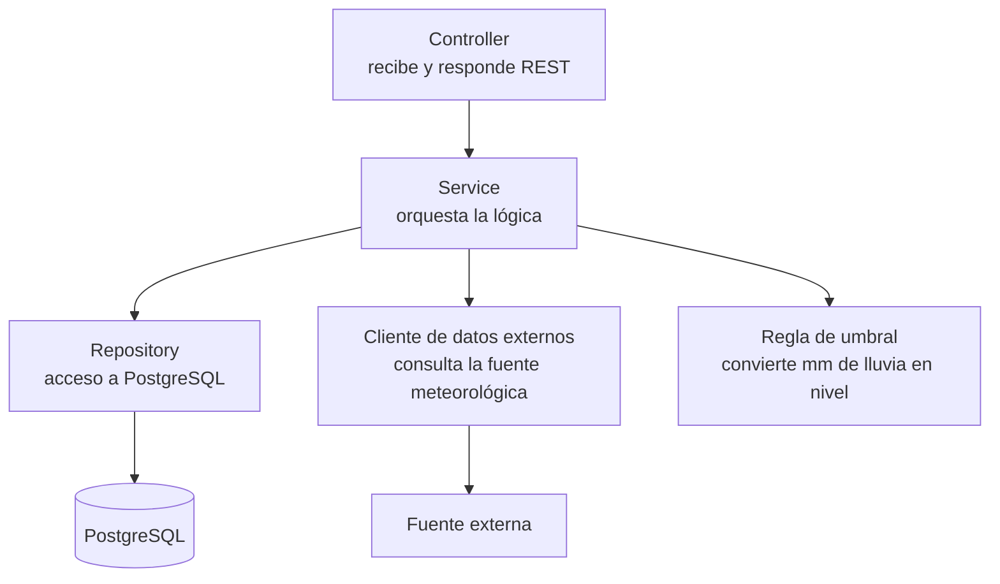
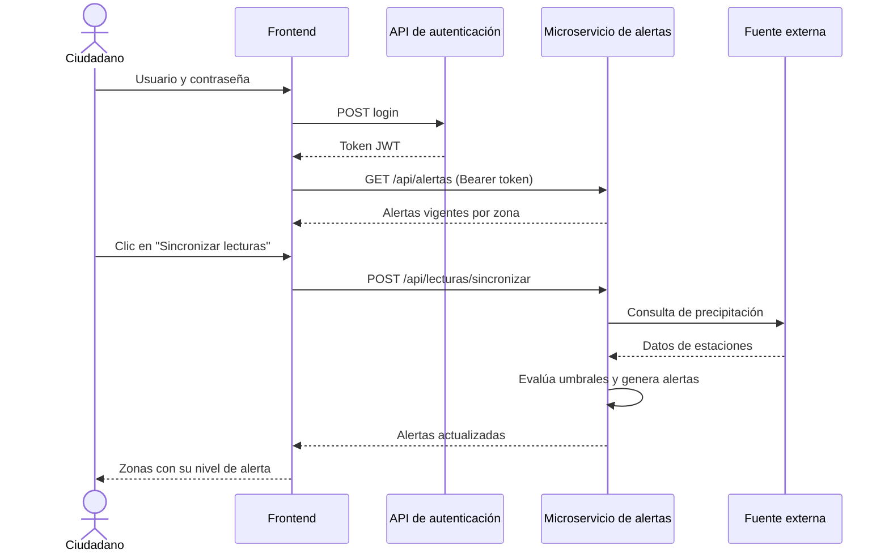

# Diseño de aplicación

**Proyecto:** Sistema de Alertas Tempranas de Crecientes — Villavicencio
**Asignatura:** Telemática 1 · Proyecto final · 2026-II · Universidad de los Llanos
**Ubicación en el repositorio:** `docs/aplicacion.md`

---

## 1. Objetivo

Describir qué hace el sistema desde el punto de vista del usuario y cómo está organizado por dentro: pantallas del frontend, capas del microservicio de alertas, endpoints y reglas de negocio.

---

## 2. Funcionalidad del MVP

### 2.1 Actor

| Actor | Descripción |
|---|---|
| Ciudadano | Persona de una comunidad cercana a un río o caño de Villavicencio que consulta el estado de riesgo de su zona. Debe iniciar sesión para usar el sistema |

### 2.2 Casos de uso

| Código | Caso de uso | Servicio que lo atiende | Resultado |
|---|---|---|---|
| CU-01 | Iniciar sesión | API de autenticación | El usuario obtiene un token y accede a la pantalla de alertas |
| CU-02 | Consultar alertas vigentes por zona | Microservicio de alertas | El usuario ve cada zona con su nivel de alerta |
| CU-03 | Actualizar datos de lluvia | Microservicio de alertas | El sistema consulta la fuente externa, evalúa los umbrales y refresca las alertas |

El **CU-03 es la funcionalidad de negocio** que se demuestra en la sustentación después del login: es el flujo del segundo servicio que el PDF exige poder ejecutar desde el frontend.

### 2.3 Niveles de alerta

| Nivel | Significado | Color en pantalla |
|---|---|---|
| `NORMAL` | Lluvia dentro de lo habitual; sin riesgo de creciente | Verde |
| `PRECAUCION` | Lluvia acumulada relevante; se recomienda estar atento | Amarillo |
| `PELIGRO` | Lluvia intensa; posible creciente, se recomienda prepararse para evacuar | Rojo |

Una zona que aún no tiene lecturas se muestra como "Sin datos" en gris. No es un nivel de alerta, sino un estado de pantalla que indica que falta pulsar "Sincronizar lecturas" en el tablero.

### 2.4 Fuera de alcance del MVP

- Notificaciones por SMS, correo o aplicación móvil.
- Mapas interactivos.
- Roles y administración de zonas o usuarios.
- Histórico y estadísticas de lluvias.
- Actualización automática programada.

Estos puntos pueden formar parte de una siguiente iteración del proyecto, pero no del alcance actual del MVP.

---

## 3. Frontend

Tecnología: React con Vite. El frontend solo presenta información y llama a los servicios; **no contiene lógica de negocio** (no decide niveles de alerta).

### 3.1 Pantallas

| Pantalla | Ruta | Acceso | Función |
|---|---|---|---|
| Login | `/login` | Público | Formulario de usuario o correo y contraseña, con enlace al registro |
| Registro | `/registro` | Público | Crea un usuario en la API de autenticación |
| Tablero | `/estaciones` | Solo con sesión iniciada | Una tarjeta por zona con su nivel y el botón "Sincronizar lecturas" (CU-02 y CU-03) |
| Alertas | `/alertas` | Solo con sesión iniciada | Solo las zonas en `PRECAUCION` o `PELIGRO`, la más grave primero (CU-02) |
| Zonas | `/zonas` | Solo con sesión iniciada | CRUD de zonas de riesgo: crear, editar y eliminar |

La barra superior (`Layout`) muestra el usuario y el botón "Salir" en las pantallas con sesión. Cualquier otra ruta redirige a `/estaciones`, y `RutaProtegida` envía a `/login` si no hay sesión.

### 3.2 Comportamiento de cada pantalla

**Login**

1. El usuario escribe usuario o correo y contraseña.
2. Si algún campo está vacío, el formulario no se envía.
3. Se llama al login de la API de autenticación.
4. Si es exitoso, se guarda el token en `sessionStorage` y se navega a `/estaciones`.
5. Si falla, se muestra "Usuario o contraseña incorrectos" (o un mensaje de servicio no disponible si no hubo respuesta).
6. Mientras espera la respuesta, el botón queda deshabilitado.

**Tablero**

1. Al abrir la pantalla, consulta las alertas vigentes (CU-02) y repite la consulta cada 5 segundos.
2. Muestra una tarjeta por zona con su nombre, cuerpo de agua, comunidades, nivel (con color), mensaje, lluvia acumulada en mm y fecha y hora de la última lectura.
3. El botón "Sincronizar lecturas" ejecuta el CU-03 y muestra la lista actualizada que devuelve el servicio.
4. "Salir" borra el token y regresa a `/login`.

**Alertas**

1. Usa la misma consulta del tablero y filtra en el navegador las zonas en `PRECAUCION` o `PELIGRO`.
2. Si ninguna zona está en riesgo, lo dice; si aún no hay lecturas, indica que se sincronice desde el tablero.

**Zonas**

1. Lista las zonas con su cuerpo de agua, comunidades y código de estación.
2. El formulario sirve para crear una zona o editar la seleccionada con "Editar".
3. Al guardar, el servicio valida campos obligatorios, nombre y estación únicos; responde `400` o `409` con un mensaje legible.
4. "Eliminar" pide confirmación y borra en cascada las lecturas y alertas de la zona.
5. Los cambios se guardan en PostgreSQL y sobreviven a reinicios.

Estados que manejan las pantallas:

| Estado | Qué se muestra |
|---|---|
| Cargando | Indicador de carga |
| Sin datos | Zonas en gris con "Sin datos" y la indicación de pulsar "Sincronizar lecturas" |
| Con datos | Tarjetas de color según el nivel |
| Error | Mensaje claro y las zonas que ya se mostraban, si las había |
| Modo demostración | Aviso visible cuando el microservicio no responde y se usan datos simulados (ver README) |

### 3.3 Organización del código

```
frontend/src/
├── pages/
│   ├── LoginPage.jsx
│   ├── RegistroPage.jsx
│   ├── EstacionesPage.jsx    # Tablero de zonas y botón "Sincronizar lecturas"
│   ├── AlertasPage.jsx       # Zonas en precaución o peligro
│   └── ZonasPage.jsx         # CRUD de zonas de riesgo
├── components/
│   ├── Layout.jsx            # Barra superior con usuario y "Salir"
│   ├── RutaProtegida.jsx     # Redirige a /login si no hay token
│   └── ChipModoDemo.jsx      # Aviso de modo demostración
├── context/
│   ├── AuthContext.jsx       # AuthProvider: token, login, registro y cierre de sesión
│   ├── sesionContext.js      # El contexto de React de la sesión
│   └── useAuth.js            # Hook para leer la sesión desde las pantallas
├── api/
│   ├── apiClient.js          # fetch común: agrega el token y normaliza errores
│   ├── authApi.js            # Llamadas a la API de autenticación
│   ├── alertasApi.js         # Llamadas al microservicio de alertas y nivel → color
│   └── alertasMock.js        # Datos simulados con el mismo contrato
├── utils/
│   └── formato.js            # Fechas y milímetros para mostrar
├── App.jsx                   # Definición de rutas
└── main.jsx
```

| Módulo | Responsabilidad |
|---|---|
| `apiClient` | Enviar cada petición con `Authorization: Bearer <token>`, cerrar la sesión ante un `401` y convertir los errores en mensajes legibles |
| `authApi` | Login y registro contra la API de autenticación |
| `alertasApi` | Consultar alertas y pedir la sincronización; es el único lugar donde se traduce el nivel a un color |
| `AuthContext` / `useAuth` | Guardar, leer y borrar el token, y exponer el usuario a las pantallas |
| `RutaProtegida` | Impedir el acceso a las pantallas con sesión sin token |

Las páginas no llaman directamente a `fetch`: lo hacen a través de `src/api/`. Así, si cambia una ruta de un servicio, solo se modifica un archivo.

### 3.4 Rutas que usa el frontend

Gracias al proxy descrito en el documento de infraestructura, el navegador solo llama a su propio origen:

| Acción | Ruta que llama el navegador | Servicio de destino |
|---|---|---|
| Login | `POST /auth-api/api/auth/login` | API de autenticación |
| Registro | `POST /auth-api/api/auth/register` | API de autenticación |
| Consultar alertas | `GET /alertas-api/api/alertas` | Microservicio de alertas |
| Sincronizar lecturas | `POST /alertas-api/api/lecturas/sincronizar` | Microservicio de alertas |

---

## 4. Microservicio de alertas

Tecnología: Java con Spring Boot, Spring Web, Spring Data JPA y PostgreSQL. Es el servicio de dominio del proyecto.

### 4.1 Capas



| Capa | Responsabilidad | No debe hacer |
|---|---|---|
| Controller | Recibir peticiones HTTP, validar lo básico y devolver JSON con el código HTTP correcto | Contener lógica de negocio ni acceder a la base de datos |
| Service | Coordinar el proceso: pedir datos, evaluar el nivel, guardar lecturas y alertas | Conocer detalles de HTTP ni del formato de la fuente externa |
| Repository | Leer y escribir en PostgreSQL | Tomar decisiones de negocio |
| Cliente de datos externos | Consultar la fuente meteorológica y traducir su respuesta al modelo propio | Guardar datos |
| Regla de umbral | Convertir la precipitación en un nivel de alerta | Consultar bases de datos o servicios |

### 4.2 Organización del código

Paquete base: `co.edu.unillanos.sisalert.alertas`.

```
alertas-service/src/main/java/co/edu/unillanos/sisalert/alertas/
├── controller/     ZonaController, AlertaController, LecturaController
├── service/        ZonaService, AlertaService, SincronizacionService
├── repository/     ZonaRepository, LecturaRepository, AlertaRepository
├── model/          Zona, Lectura, Alerta, NivelAlerta (enum)
├── client/         ClienteDatosExternos (interfaz), ClienteIdeam, ClienteSimulado
├── rules/          ReglaDeUmbral
├── dto/            AlertaDto, ZonaDto
└── config/         CargaInicial (zonas reales) y CorsConfig
```

Que el cliente de datos externos sea una **interfaz** permite cambiar de fuente (IDEAM u otra) sin tocar el resto del servicio, y simular la fuente en las pruebas.

### 4.3 Datos iniciales

Al arrancar, el servicio carga las tres zonas reales de riesgo en PostgreSQL a través de `CargaInicial` (solo si la tabla está vacía):

| Zona | Estación IDEAM | Código | Cuerpos de agua | Comunidades (POMCA) |
|---|---|---|---|---|
| Zona Guatiquía Norte | ICA Villavicencio | `0035035100` | Río Guatiquía, Caño Parrado, Caño Gramalote, Qda Grande, Qda Honda, Caño Buque | Barzal Alto, Barzal Bajo, Siete de Agosto, Villa Lorena, Mancera, La Nohora, El Triunfo |
| Zona Guayuriba Sur | Guayuriba | `3502700090` | Río Guayuriba, Caño Rosablanca, Caño La Cuerera | Apiay, Catumare, Playa Rica, La Esperanza, La Nohora Rural, Vanguardia |
| Zona Caño Grande Centro | La Libertad | `0035025110` | Caño Grande, Caño Maizaro, Quebrada La Unión | Porvenir, Bello Horizonte, Villacentro, La Rosita, Marsella, Porfía |

El detalle de los campos está en `docs/modelo-datos.md`.

---

## 5. Endpoints del microservicio de alertas

Todos los endpoints devuelven JSON. Prefijo común: `/api`.

| Método | Ruta | Descripción | Caso de uso |
|---|---|---|---|
| GET | `/api/zonas` | Lista de zonas de riesgo | Apoyo a CU-02 |
| GET | `/api/zonas/{id}` | Una zona por id | CRUD |
| POST | `/api/zonas` | Crea una zona | CRUD |
| PUT | `/api/zonas/{id}` | Actualiza una zona | CRUD |
| DELETE | `/api/zonas/{id}` | Elimina una zona y sus lecturas/alertas en cascada | CRUD |
| GET | `/api/alertas` | Alerta vigente de cada zona | CU-02 |
| POST | `/api/lecturas/sincronizar` | Consulta la fuente externa, guarda lecturas y regenera alertas | CU-03 |

### 5.1 `GET /api/zonas`

Respuesta `200 OK`:

```json
[
  {
    "id": 1,
    "nombre": "Zona de ejemplo 1",
    "cuerpoAgua": "Caño de ejemplo",
    "comunidades": "Barrio A, Barrio B",
    "codigoEstacion": "0035035100"
  }
]
```

### 5.2 `GET /api/alertas`

Devuelve una entrada por zona. Si la zona no tiene alerta todavía, `nivel` llega como `null` y el frontend muestra "Sin datos".

Respuesta `200 OK`:

```json
[
  {
    "zonaId": 1,
    "zona": "Zona de ejemplo 1",
    "cuerpoAgua": "Caño de ejemplo",
    "comunidades": "Barrio A, Barrio B",
    "nivel": "PELIGRO",
    "mensaje": "Lluvia intensa. Prepárese para una posible evacuación.",
    "precipitacionMm": 62.5,
    "fechaHora": "2026-10-01T15:30:00"
  }
]
```

### 5.3 `POST /api/lecturas/sincronizar`

No requiere cuerpo. Ejecuta el proceso descrito en la sección 7 y devuelve la misma estructura que `GET /api/alertas`, ya actualizada.

| Código | Cuándo |
|---|---|
| `200 OK` | El proceso terminó y se devuelven las alertas actualizadas |
| `502 Bad Gateway` | La fuente externa no respondió o devolvió datos inválidos |

Respuesta de error:

```json
{
  "error": "FUENTE_EXTERNA_NO_DISPONIBLE",
  "mensaje": "No fue posible consultar la fuente de datos meteorológicos."
}
```

### 5.4 CRUD de zonas

`POST /api/zonas` y `PUT /api/zonas/{id}` reciben:

```json
{
  "nombre": "Zona Guatiquía Norte",
  "cuerpoAgua": "Río Guatiquía · Caño Parrado",
  "comunidades": "Barzal Alto, Siete de Agosto",
  "codigoEstacion": "0035035100"
}
```

| Código | Cuándo |
|---|---|
| `201 Created` | Zona creada; devuelve la zona con su `id` |
| `200 OK` | Zona actualizada |
| `204 No Content` | Zona eliminada (lecturas y alertas en cascada) |
| `400 Bad Request` | Campo vacío o demasiado largo; `{"error":"SOLICITUD_INVALIDA","mensaje":"..."}` |
| `404 Not Found` | El id no existe; `{"error":"NO_ENCONTRADO","mensaje":"..."}` |
| `409 Conflict` | Nombre o código de estación duplicado; `{"error":"CONFLICTO","mensaje":"..."}` |

Los datos se guardan en PostgreSQL y sobreviven a reinicios del servicio.

---

## 6. Regla de umbral

La regla decide el nivel de alerta de una zona a partir de la **lluvia acumulada del día** (en milímetros) registrada por la estación de referencia.

| Condición | Nivel |
|---|---|
| Lluvia menor al umbral de precaución | `NORMAL` |
| Lluvia mayor o igual al umbral de precaución y menor al de peligro | `PRECAUCION` |
| Lluvia mayor o igual al umbral de peligro | `PELIGRO` |

Los umbrales se configuran en `application.properties`, no en el código:

```properties
alertas.umbral.precaucion-mm=40
alertas.umbral.peligro-mm=80
```

Los valores se definen con criterio meteorológico a partir de los datos históricos del IDEAM para la Orinoquía (lluvia fuerte > 50 mm/día adaptada a 40 mm para alerta temprana; peligro en 80 mm por crecientes históricas del río Guatiquía).

Mensaje asociado a cada nivel:

| Nivel | Mensaje |
|---|---|
| `NORMAL` | Sin riesgo por lluvias en este momento. |
| `PRECAUCION` | Lluvia acumulada relevante. Manténgase atento a la evolución del río. |
| `PELIGRO` | Lluvia intensa. Prepárese para una posible evacuación. |

En el MVP la regla considera solo la lluvia. El nivel del río y otras variables quedan para la entrega final.

---

## 7. Flujo principal

### 7.1 Secuencia



### 7.2 Qué hace el servicio al sincronizar

Para cada zona:

1. Consulta la precipitación acumulada del día de su estación de referencia.
2. Guarda una `Lectura` con el valor, la fecha y hora y la fuente.
3. Aplica la regla de umbral y obtiene el nivel.
4. Marca como no vigente la alerta anterior de la zona, si existía.
5. Crea una `Alerta` nueva, vigente, con el nivel y su mensaje.

Si la fuente externa falla antes de terminar, no se modifica ninguna alerta y se responde con el error `502`.

---

## 8. Manejo de errores

| Situación | Comportamiento |
|---|---|
| Credenciales incorrectas | El frontend muestra "Credenciales incorrectas" y permanece en el login |
| API de autenticación sin respuesta | El frontend muestra "No se pudo conectar con el servicio" |
| Usuario sin token abre `/alertas` | `RutaProtegida` lo redirige a `/login` |
| Fuente externa no disponible | El microservicio responde `502`; el frontend avisa del problema y conserva las alertas que ya mostraba |
| Zona sin lecturas | `nivel` llega vacío y el frontend muestra "Sin datos" |
| Microservicio de alertas apagado | El frontend muestra un mensaje de error en la pantalla de alertas |

---

## 9. Decisiones y justificación

| Decisión | Justificación |
|---|---|
| El frontend no calcula niveles | Mantiene la lógica de negocio en el servicio de dominio, como pide la separación de responsabilidades |
| Servicios del frontend separados de las páginas | Un cambio en una ruta se corrige en un solo archivo |
| Arquitectura por capas en el microservicio | Es un patrón conocido, fácil de explicar y de probar |
| Cliente de datos externos como interfaz | Permite cambiar la fuente de datos sin reescribir el servicio |
| Umbrales en configuración | Se ajustan sin recompilar |
| Una sola regla, basada en lluvia acumulada | Suficiente para demostrar la funcionalidad; evita complejidad innecesaria en el MVP |
| Sincronización bajo demanda con un botón | Hace visible el flujo del segundo servicio durante la demostración |
| Código `502` para fallas de la fuente externa | Distingue un fallo del proveedor de datos de un fallo del propio servicio |

---

## 10. Lista de verificación

- [ ] Casos de uso y niveles de alerta revisados por el equipo
- [ ] Pantallas y rutas del frontend acordadas con quien implementa el login y la vista de alertas
- [ ] Paquete base del microservicio definido
- [ ] Endpoints y formatos de respuesta revisados por quien construye el microservicio
- [ ] Umbrales definidos (Paso 4)
- [ ] Zonas y estaciones de referencia definidas (Paso 4)
- [ ] Documento revisado por al menos otro integrante