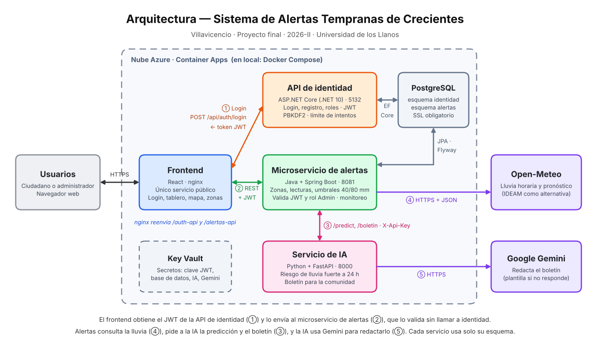
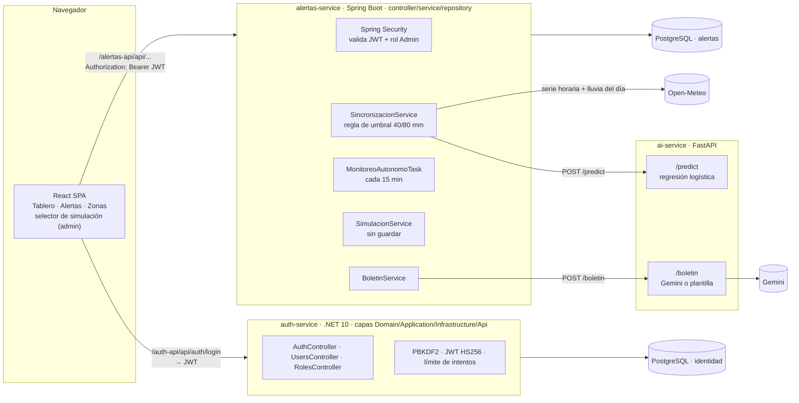
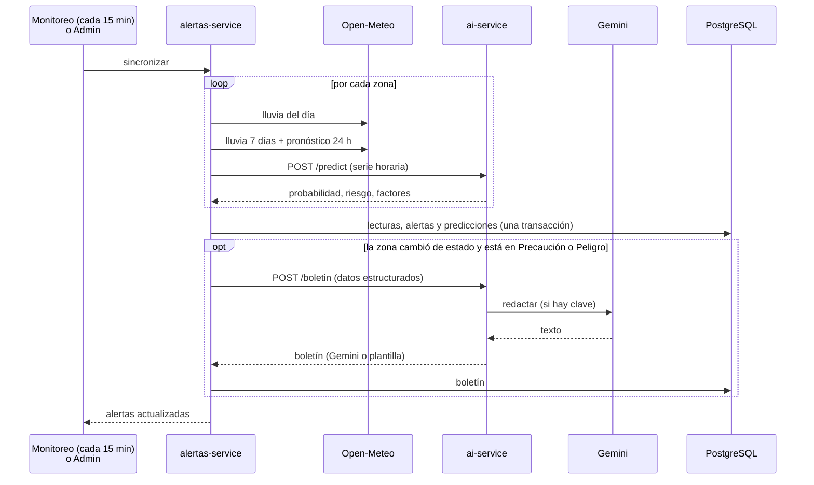

# Entregable 2 · Arquitectura de la aplicación (cloud-native)

Cómo están construidos y cómo se comunican los servicios de SisAlert. La infraestructura de Azure donde corren está en `arquitectura-nube.md`; el detalle funcional del MVP, en `aplicacion.md`.

> La imagen es la versión final para la entrega; el diagrama Mermaid de abajo queda como fuente editable.

## 1. Servicios y contratos

| Contrato | Servicio | Autenticación |
|---|---|---|
| `POST /api/auth/login`, `/register` | identidad | Pública, con límite de 10 intentos por minuto por IP |
| `GET /api/zonas`, `/api/alertas`, histórico | alertas | JWT de cualquier usuario |
| `POST /api/lecturas/sincronizar`, CRUD de zonas, `/api/simulacion/{escenario}` | alertas | JWT con rol `Admin` |
| `POST /predict`, `POST /boletin` | IA | Solo red interna + `X-Api-Key` |
| `/health`, `/actuator/health/*` | todos | Pública dentro de Azure; no expone detalles |

Todos los errores siguen el mismo formato: `{"error": "CODIGO", "mensaje": "texto"}`.

## 2. Principios cloud-native que cumple

| Principio | Cómo se cumple |
|---|---|
| **Un servicio, una responsabilidad** | Identidad (usuarios y tokens), alertas (zonas, lecturas, reglas y monitoreo) e IA (modelo y boletines) se despliegan y escalan por separado |
| **Base de datos por servicio** | Esquemas `alertas` e `identidad`, cada uno con sus migraciones (Flyway y EF Core) y su usuario. Ningún servicio lee las tablas de otro |
| **Sin estado en el proceso** | Las sesiones son JWT. Los datos viven en PostgreSQL. El modelo de IA se carga desde la imagen |
| **Configuración externa** | Todo por variables de entorno con perfiles `dev` y `prod` (12-factor). Falla temprana si falta un secreto |
| **Observabilidad** | Logs a la consola, sondas de vida y disponibilidad, `/modelo` con la ficha del modelo |
| **Tolerancia a fallos** | Si falla la IA, la sincronización sigue con la regla de umbral. Si falla Gemini, se usa la plantilla. Si falla Open-Meteo, responde 502 y no cambia ninguna alerta. Si falla la base, la sonda de disponibilidad saca la réplica del tráfico |
| **Seguridad en profundidad** | Un solo servicio público, JWT y roles, SSL a la base, usuarios con mínimo privilegio, encabezados de seguridad |
| **Despliegues sin cortes** | Apagado ordenado y migraciones que se aplican solas al arrancar |

## 3. Flujo principal: sincronización con IA

## 4. Modo simulación

El administrador elige un escenario en la interfaz (seca, tormenta o creciente) y el frontend consulta `GET /api/simulacion/{escenario}`. El backend calcula al vuelo el semáforo, la predicción de IA y el boletín, que guarda solo en memoria. **No escribe en la base:** los demás usuarios siguen viendo los datos reales.
