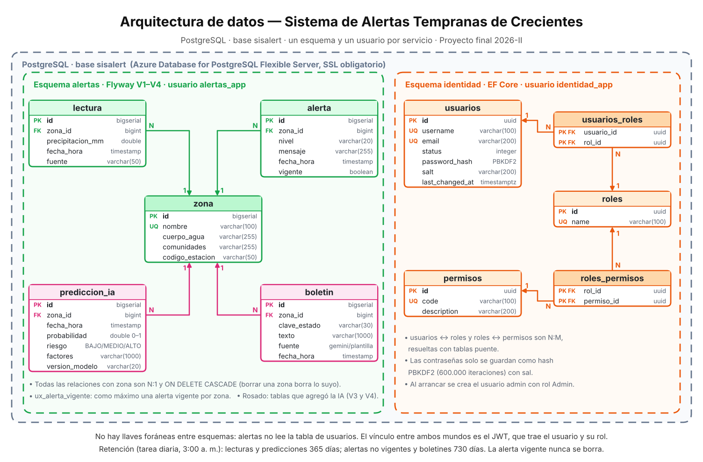
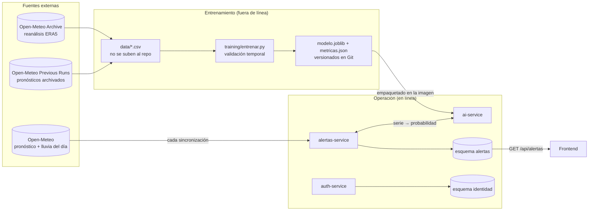
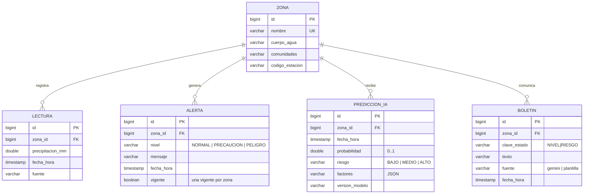

# Entregable 3 · Arquitectura de datos

Qué datos maneja SisAlert, dónde viven, cómo fluyen y cuánto se conservan. El detalle columna por columna de las tablas de alertas está en `modelo-datos.md`; el del modelo de IA, en `ia.md`.

> La imagen es la versión final para la entrega; el diagrama Mermaid de abajo queda como fuente editable.

## 1. Flujo de datos

## 2. Almacenamiento

Una instancia de **PostgreSQL 16** (en Azure: Flexible Server), base `sisalert`, con **un esquema por servicio**:

| Esquema | Tablas | Dueño (usuario de base) | Migraciones |
|---|---|---|---|
| `alertas` | `zona`, `lectura`, `alerta`, `prediccion_ia`, `boletin` | `alertas_app` | Flyway V1–V4 |
| `identidad` | `usuarios`, `roles`, `permisos`, `usuarios_roles`, `roles_permisos` | `identidad_app` | EF Core |

Fuera de la base:
- **Modelo de IA:** `ai-service/modelo/modelo.joblib` (5 KB), versionado en Git y empaquetado en la imagen.
- **Datos de entrenamiento:** se regeneran con `training/descargar_datos.py`.

## 3. Clasificación y protección

| Dato | Sensibilidad | Protección |
|---|---|---|
| Usuario y correo | Personal (bajo) | Esquema aislado; solo `identidad_app` lo lee |
| Contraseña | Secreto | Solo el hash PBKDF2 (600.000 iteraciones) con sal; nunca en claro |
| Lluvia, alertas, predicciones y boletines | Públicos (clima) | Lectura con sesión; escritura solo del sistema o de un Admin |
| Claves (JWT, base, IA, Gemini) | Secreto | Key Vault y variables de entorno; nunca en Git |

- **En tránsito:** TLS hacia la base (obligatorio), HTTPS público y HTTPS interno en Container Apps.
- **En reposo:** cifrado del servicio gestionado de Azure.
- **Gemini** solo recibe datos de clima y nombres de barrios. Nunca recibe datos personales.

## 4. Ciclo de vida y retención

| Dato | Se crea | Se conserva | Lo borra |
|---|---|---|---|
| Lecturas | Cada sincronización (cada 15 min en producción) | 365 días | Tarea diaria de retención (3:00 a. m.) |
| Predicciones de IA | Cada sincronización con IA disponible | 365 días | Retención |
| Alertas no vigentes | Al cambiar el nivel de una zona | 730 días | Retención; **la vigente nunca se borra** |
| Boletines | Solo al cambiar el estado de una zona en alerta | 730 días | Retención |
| Zonas | CRUD del admin | Indefinido | Admin; al borrar una zona se borra en cascada todo lo suyo |
| Usuarios | Registro o admin | Indefinido | Admin (protege al último administrador) |

Los plazos se cambian con `ALERTAS_RETENCION_LECTURAS_DIAS` y `ALERTAS_RETENCION_ALERTAS_DIAS`.

**Volumen estimado:** 3 zonas × 96 sincronizaciones al día ≈ 290 lecturas y 290 predicciones diarias, unas 105.000 filas al año por tabla. Es poco para PostgreSQL B1ms.

## 5. Respaldo y recuperación

- **Azure PostgreSQL Flexible Server:** copias automáticas diarias con restauración a cualquier punto de los últimos 7 días (configurable hasta 35).
- **Esquema reproducible:** las migraciones recrean todas las tablas en una base vacía, y las zonas y el usuario admin se siembran solos.
- **Modelo de IA:** versionado en Git; se puede reentrenar con los scripts de `ai-service/training`.
