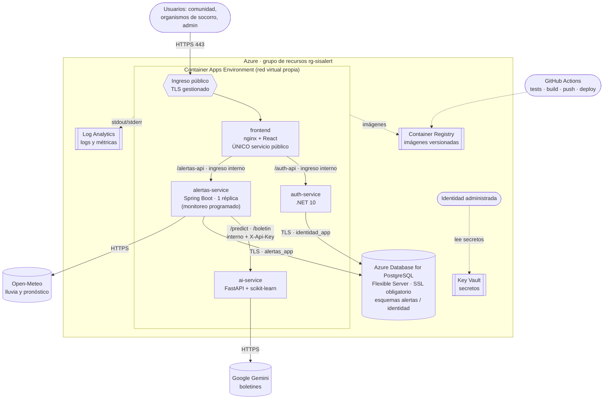

# Entregable 1 · Arquitectura de infraestructura en la nube (Azure)

Arquitectura objetivo de SisAlert en Microsoft Azure. Para la ejecución local con cuatro terminales, ver `infraestructura.md`. El código ya está preparado para este despliegue; la creación de los recursos (Docker, CI/CD e IaC) es el paso siguiente.

## 1. Diagrama

## 2. Componentes

| Recurso de Azure | Qué aloja | Configuración clave |
|---|---|---|
| **Container Apps Environment** | Los 4 contenedores, en una red virtual propia | Plan de consumo: se paga por uso |
| `frontend` (Container App) | nginx con la app React compilada; reenvía `/auth-api` y `/alertas-api` (`frontend/nginx/default.conf.template`) | **Ingreso externo**, HTTPS obligatorio. 1 a 3 réplicas por carga HTTP |
| `auth-service` | API de identidad (.NET 10) | **Ingreso interno**. 1 a 3 réplicas |
| `alertas-service` | Microservicio de alertas (Spring Boot) | **Ingreso interno**. **1 réplica fija**: el monitoreo automático corre dentro del proceso y con 2 réplicas sincronizaría dos veces |
| `ai-service` | Modelo predictivo y boletines (FastAPI) | **Ingreso interno** y `X-Api-Key`. 1 a 2 réplicas |
| **Azure Database for PostgreSQL Flexible Server** | Base `sisalert`, esquemas `alertas` e `identidad` | Plan Burstable B1ms, SSL obligatorio, copias automáticas (7 días), firewall solo para servicios de Azure |
| **Key Vault** | Clave JWT, contraseñas de la base, contraseña inicial de admin, `AI_API_KEY`, `GEMINI_API_KEY` | Los Container Apps los leen con su identidad administrada, sin credenciales en el código |
| **Container Registry** | Imágenes de los 4 servicios, etiquetadas por commit | Plan Basic |
| **Log Analytics** | Logs de todos los contenedores | Las apps escriben en la consola y Azure los recoge |

## 3. Red y seguridad

- **Un solo punto de entrada público:** el ingreso del `frontend`, con TLS gestionado por Azure. Identidad, alertas e IA tienen ingreso **interno**: no se pueden alcanzar desde Internet.
- **El navegador solo habla con un origen.** nginx reenvía `/auth-api` y `/alertas-api` a los servicios internos, así que no hay CORS en producción.
- **Base de datos:**
  - SSL obligatorio. alertas-service se niega a arrancar si `DB_URL` no lo pide.
  - Un usuario por servicio, con permisos solo sobre su esquema (`infra/db/usuarios-por-servicio.sql`).
- **Secretos:** solo en Key Vault y nunca en el repositorio. En producción, si falta uno, el servicio no arranca y dice cuál falta.
- **Encabezados de seguridad del frontend:** CSP restrictiva, `X-Frame-Options: DENY`, HSTS y `nosniff`. nginx no revela su versión.
- **Aplicación:**
  - JWT validado en alertas-service, con roles.
  - PBKDF2 para las contraseñas.
  - Máximo 10 intentos de login por minuto por IP. La IP real llega en `X-Forwarded-For` y la API confía en los últimos `Proxy__SaltosConfiables = 2` saltos.

## 4. Sondas de salud

| Servicio | Vida (liveness) | Disponibilidad (readiness, verifica la base) |
|---|---|---|
| frontend | `GET /health` | — |
| auth-service | `GET /health` | `GET /health/ready` |
| alertas-service | `GET /actuator/health/liveness` | `GET /actuator/health/readiness` |
| ai-service | `GET /health` | — |

Si se cae la base, la sonda de disponibilidad falla: Azure deja de enviarle tráfico a esa réplica, sin reiniciarla, y la vuelve a usar cuando la base regresa. Esto se probó en local deteniendo PostgreSQL. Se recomienda un tiempo de espera de 5 s en la sonda de disponibilidad.

## 5. Variables por servicio

Todas salen de `.env.example`. Los valores sensibles se configuran como referencias a Key Vault.

| Servicio | Variables |
|---|---|
| frontend | `PORT=8080`, `AUTH_API_URL`, `ALERTAS_API_URL` (URLs internas de Container Apps) |
| auth-service | `ASPNETCORE_ENVIRONMENT=Production`, `ConnectionStrings__Identity` 🔒, `Jwt__Key` 🔒, `Seed__AdminPassword` 🔒, `Persistencia__EsquemaHistorial=identidad`, `Proxy__SaltosConfiables=2` |
| alertas-service | `SPRING_PROFILES_ACTIVE=prod`, `DB_URL`, `DB_USER`, `DB_PASSWORD` 🔒, `Jwt__Key` 🔒, `ALERTAS_CORS_ORIGENES`, `AI_SERVICE_URL`, `AI_API_KEY` 🔒 |
| ai-service | `AI_API_KEY` 🔒, `GEMINI_API_KEY` 🔒 (opcional) |

🔒 = secreto en Key Vault.

## 6. Escalado y disponibilidad

- **Servicios sin estado** (frontend, identidad e IA): escalan horizontalmente por número de peticiones simultáneas. El estado vive en PostgreSQL.
- **alertas-service:** una réplica fija, porque el monitoreo programado vive en el proceso. Para escalarlo habría que separar el monitoreo en un *Container Apps Job* programado (trabajo futuro).
- **Apagado ordenado:** Spring termina las peticiones en curso antes de apagarse (`server.shutdown=graceful`), así que los despliegues no cortan sincronizaciones.
- **Base de datos:** copias automáticas y restauración a un punto en el tiempo, que provee el servicio gestionado.

## 7. Automatización (siguiente paso)

1. **Docker:** un `Dockerfile` por servicio y `docker-compose.yml` para levantar todo en local con un comando.
2. **GitHub Actions:** en cada PR, `mvnw test`, `dotnet test`, `pytest`, lint y build. En `main`, construir las imágenes, subirlas a ACR y actualizar los Container Apps.
3. **Infraestructura como código** (Bicep o Terraform): crea todo lo de este diagrama de forma repetible.

## 8. Costo estimado (Azure for Students, USD 100 de crédito)

| Recurso | Aproximado al mes |
|---|---|
| PostgreSQL Flexible B1ms + 32 GB | USD 13–18 |
| Container Apps (plan de consumo, pocas réplicas) | USD 0–10 |
| Container Registry Basic | USD 5 |
| Key Vault + Log Analytics | USD 0–5 |
| **Total** | **unos USD 20–35** |

Para no gastar el crédito: detener el servidor de PostgreSQL y escalar los Container Apps a 0 réplicas cuando no se use. Gemini con plan gratuito no suma costo.
