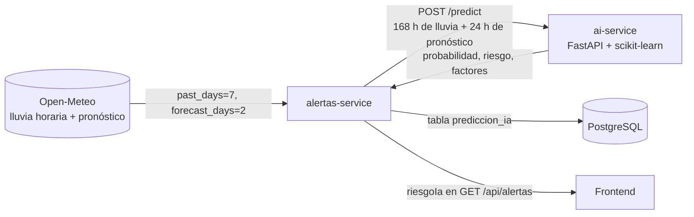

# Servicio de IA: riesgo de lluvia fuerte en las próximas 24 horas

Ficha del modelo predictivo de SisAlert: qué predice, con qué datos, cómo se evaluó y qué límites tiene. Los números de este documento salen de `ai-service/modelo/metricas.json`, que se regenera al entrenar.

## 1. Qué hace y por qué

La regla de umbral de alertas-service mira la lluvia **de hoy**: 40 mm es PRECAUCIÓN y 80 mm es PELIGRO. Sirve para saber cómo está la zona ahora, pero no anticipa. El modelo de IA mira **hacia adelante**:

> Dada la lluvia de la última semana en la zona y el pronóstico meteorológico de las próximas 24 horas, ¿cuál es la probabilidad de que en las **próximas 24 horas** caigan **40 mm o más**?

Responde con:

| Campo | Qué es |
|---|---|
| `probabilidad` | Entre 0 y 1 |
| `riesgo` | `BAJO`, `MEDIO` o `ALTO` (ver §5) |
| `factores` | Las 3 variables que más pesaron y si **aumentan** o **disminuyen** el riesgo |

La IA **complementa** la regla de umbral; no la reemplaza. Si el servicio de IA no responde, la sincronización y el semáforo siguen funcionando igual.

## 2. Arquitectura



- **ai-service** solo sirve el modelo: no guarda estado ni consulta Internet. Recibe la serie y devuelve la predicción.
- **alertas-service** obtiene la serie de la fuente de datos, llama a la IA en cada sincronización (manual o automática) y guarda el resultado en `prediccion_ia` (migración V3).
- Con la fuente `escenario`, alertas-service genera una serie sintética coherente con cada nivel. Así la IA también "ve" la tormenta durante la demostración.

## 3. Datos

| | Fuente | Uso |
|---|---|---|
| Lluvia observada | Open-Meteo Historical Weather API (reanálisis ERA5), horaria | Historia de 7 días y **etiqueta** (lo que realmente llovió) |
| Pronóstico | Open-Meteo Previous Runs API (`precipitation_previous_day1`): lo que se pronosticaba para cada hora **un día antes** | Variables de pronóstico |

Ambas son gratuitas y no requieren clave. Se descargan con `python -m training.descargar_datos`.

- **Periodo con pronósticos archivados:** desde 2024-02, unas 48.700 horas útiles entre dos series.
- **Tasa de eventos:** un 3,3 % de las horas, 1.152 horas con evento en desarrollo y 460 en la prueba.
- **Zonas:** Guatiquía Norte y Caño Grande Centro caen en la **misma celda de la grilla** de Open-Meteo y tienen series idénticas. Se entrena con las dos series distintas (Guatiquía y Guayuriba) para no contar dos veces los mismos datos.

## 4. Variables (17)

Las calcula `ai-service/app/caracteristicas.py`, **el mismo código** en el entrenamiento y en el servicio. Una prueba automática verifica que coincidan.

- **Lluvia pasada:** acumulados de 1, 3, 6, 12, 24, 48 y 72 horas y de 7 días (saturación del suelo), intensidad máxima en 24 h y horas con lluvia en el último día.
- **Pronóstico:** acumulados de las próximas 6 y 24 horas e intensidad máxima pronosticada.
- **Calendario:** mes y hora del día, como ángulos (seno y coseno) para que diciembre quede junto a enero.
- Los acumulados se transforman con `log(1 + mm)` porque la lluvia es muy asimétrica.

## 5. Entrenamiento y evaluación

**División temporal, nunca aleatoria**, para no "ver el futuro":

- **Desarrollo, 2024-02 a 2025-12:** validación cruzada por bloques. Para cada trimestre desde 2024-10 se entrena con todo lo anterior y se predice ese trimestre (5 cortes, 15 meses de predicciones fuera de muestra). Con eso se elige el modelo.
- **Prueba, 2026-01 a 2026-11:** no se usa para ninguna decisión. Solo se reporta.

**Modelos comparados.** Se elige por PR-AUC en la validación cruzada. Si el boosting no supera a la regresión logística por más de 0,02, se prefiere la logística porque sus predicciones se pueden explicar exactamente.

| Modelo | Qué es | CV ROC-AUC | CV PR-AUC | Prueba ROC-AUC | Prueba PR-AUC | Prueba Brier |
|---|---|---|---|---|---|---|
| Persistencia | "Si llovió mucho en 24 h, seguirá lloviendo" | 0,71 | 0,068 | 0,68 | 0,102 | — |
| Climatología | Frecuencia de eventos en ese mes | 0,69 | 0,067 | 0,79 | 0,133 | 0,0282 |
| Pronóstico solo | Los mm del pronóstico, sin modelo | 0,70 | 0,056 | 0,91 | 0,339 | — |
| **Regresión logística (elegida)** | 17 variables, regularizada | **0,76** | 0,068 | **0,88** | **0,321** | **0,0266** |
| Gradient boosting | Árboles poco profundos | 0,77 | 0,077 | 0,80 | 0,093 | 0,0384 |

La tasa base de la prueba es 0,030: un modelo al azar tendría PR-AUC de unos 0,03.

**Cómo se lee la tabla:**

- La regresión logística es el modelo **más estable**: queda primera o segunda en ambos periodos. Además es el único cuyo error de probabilidad (Brier) es **mejor que la climatología** en la prueba.
- En 2026 el pronóstico solo ordena un poco mejor (0,91 frente a 0,88), pero en 2024–2025 fue el peor (0,70). Además, unos milímetros no son una probabilidad. El modelo combina pronóstico, saturación del suelo y época del año, y entrega una probabilidad calibrada.
- El boosting se sobreajusta con tan pocos eventos: es bueno en validación y malo en la prueba.

**Bandas de riesgo.** La lluvia fuerte es rara, así que una probabilidad de 10 % ya es alta. Las bandas se definen **de antemano** como riesgo relativo a la tasa base del desarrollo (3,4 %):

| Banda | Probabilidad | Significado | Prueba 2026: precisión | Prueba 2026: eventos detectados |
|---|---|---|---|---|
| BAJO | < 10,3 % | Riesgo normal o menor | — | — |
| MEDIO | ≥ 10,3 % (3× lo normal) | Atención | 11 % | 76 % |
| ALTO | ≥ 20,6 % (6× lo normal) | Prepararse | 29 % | 43 % |

**Explicación de cada predicción.** En la regresión logística el aporte de cada variable es exacto: coeficiente × valor estandarizado, es decir, cuánto sube o baja el riesgo frente a una hora típica. El servicio devuelve los tres aportes más grandes. Por ejemplo, en el escenario de tormenta para Guayuriba Sur:

- Riesgo ALTO, 24 %.
- ▲ Lluvia pronosticada para las próximas 24 horas.
- ▼ Época del año (noviembre es el inicio de la temporada seca).
- ▲ Lluvia de las últimas 24 horas.

## 6. Iteración anterior: por qué se agregó el pronóstico

La **versión 1** usaba solo la lluvia pasada y tenía más datos (2015–2025, 11 años). Su resultado quedó en `modelo/experimento_v1_solo_lluvia_pasada.json`:

- Regresión logística en la prueba 2024–2025: ROC-AUC 0,78 y PR-AUC 0,11, apenas por encima de la climatología (0,76 / 0,08).
- La lluvia convectiva de los Llanos no se anticipa 24 horas solo mirando la lluvia pasada. Al agregar el pronóstico, la PR-AUC en la prueba subió de 0,11 a 0,32.

## 7. Limitaciones (para decirlas en la sustentación)

1. **Pocos datos con pronóstico:** menos de 3 años, y con muchas horas seguidas parecidas entre sí. El desempeño **varía bastante entre periodos**: es más débil en 2024–2025 (CV) que en 2026 (prueba).
2. **La etiqueta es lluvia, no inundación.** No hay un registro histórico de crecientes por barrio para entrenar. "40 mm en 24 h" es un proxy del umbral de PRECAUCIÓN, no un modelo hidráulico del río.
3. **Resolución espacial:** la grilla del reanálisis no distingue Guatiquía Norte de Caño Grande Centro. Las zonas creadas desde el CRUD usan las coordenadas del centro de Villavicencio.
4. **Precisión baja en términos absolutos:** incluso en riesgo ALTO, 7 de cada 10 alertas no terminan en 40 mm. Es una herramienta de **apoyo a la decisión**, no un sustituto de los organismos de socorro.
5. **Diferencia entre entrenamiento y producción:** al entrenar, el pronóstico es el emitido un día antes; en producción es el más reciente, que suele ser mejor. Eso puede hacer que el modelo subestime un poco el valor del pronóstico.

**Mejoras futuras:**
- Reentrenar cada trimestre a medida que se acumulan pronósticos archivados.
- Agregar caudal o nivel del río si el IDEAM publica la serie.
- Calibrar por zona.
- Probar el pronóstico de varios modelos meteorológicos (ECMWF, GFS).

## 8. IA generativa: boletín para la comunidad (Gemini)

El modelo predictivo **decide**. La IA generativa **comunica**: convierte el estado técnico de una zona en alerta en un mensaje en lenguaje sencillo para sus habitantes. Por ejemplo, para Guayuriba Sur en peligro:

> *"Vecinos de Apiay, Catumare y Playa Rica: el río Guayuriba puede crecer en las próximas horas…"*

| Decisión | Por qué |
|---|---|
| Solo zonas en PRECAUCIÓN o PELIGRO | En NORMAL no hay nada que comunicar y se ahorran llamadas |
| Se pide un boletín nuevo **solo cuando cambia el estado** de la zona (nivel y riesgo de la IA) y se guarda en la tabla `boletin` (migración V4) | Con 3 zonas son unas pocas llamadas al día, aunque el monitoreo sincronice cada pocos minutos |
| Modelo Flash-Lite, máximo unas 70 palabras, temperatura baja | Es el modelo más barato y rápido; respuestas cortas y sobrias |
| Gemini recibe **solo datos estructurados** (zona, comunidades, nivel, mm, riesgo y factores de la IA), con las instrucciones aparte, y nunca texto escrito por usuarios | Evita que alguien le inyecte instrucciones; el texto no puede inventar cifras que no estén en los datos |
| Sin clave, sin cuota o con error → **plantilla fija** con los mismos datos. Si salió la plantilla, se reintenta con Gemini cada 30 minutos | La alerta nunca depende de Gemini |
| En la simulación del administrador, los boletines se guardan en memoria, una vez por zona y estado | No se llama a Gemini en cada actualización de la pantalla |

Configuración (en `ai-service`):
- `GEMINI_API_KEY`: clave de Google AI Studio.
- `GEMINI_MODEL`: por defecto `gemini-flash-lite-latest`.

`GET /health` indica si los boletines salen de `gemini` o de `plantilla`. En el plan gratuito de Google AI Studio, Google puede usar lo enviado para mejorar sus productos. Aquí solo se envían datos del clima y nombres de barrios, nunca datos personales.

## 9. Cómo reproducirlo

```powershell
cd ai-service
python -m venv .venv
.\.venv\Scripts\pip install -r requirements-dev.txt
.\.venv\Scripts\python -m training.descargar_datos   # unos minutos; crea data/
.\.venv\Scripts\python -m training.entrenar           # crea modelo/modelo.joblib y modelo/metricas.json
.\.venv\Scripts\python -m pytest
```
