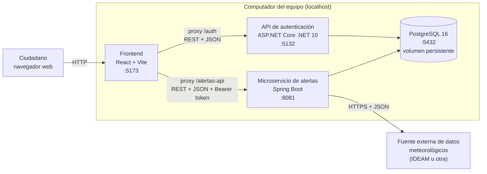

# Diseño de infraestructura

**Proyecto:** Sistema de Alertas Tempranas de Crecientes — Villavicencio
**Asignatura:** Telemática I · Proyecto final · 2026-II · Universidad de los Llanos
**Ubicación en el repositorio:** `docs/infraestructura.md`

---

## 1. Objetivo

Describir qué piezas de software componen el MVP, dónde se ejecuta cada una, en qué puerto, cómo se comunican y qué se necesita instalar para correrlas.

---

## 2. Vista general

El MVP se ejecuta en el computador del equipo como **tres procesos independientes**, más una fuente de datos externa.



Cada servicio tiene una sola responsabilidad y se puede arrancar, detener y reemplazar sin tocar a los demás. Esa separación es la que el PDF llama "microservices-oriented structure".

---

## 3. Componentes

| Componente | Tecnología | Responsabilidad | Puerto | Origen del código |
|---|---|---|---|---|
| Frontend | React + Vite | Pantalla de login, tablero, alertas y CRUD de zonas. No contiene lógica de negocio | 5173 | Carpeta `frontend/` de SisAlert |
| API de autenticación | ASP.NET Core (.NET 10) + EF Core | Registrar usuarios, validar credenciales, emitir el JWT y administrar usuarios/roles con persistencia | 5132 | Carpeta `auth-service/` (basada en `mini-identity-api-dotnet`, modificada con autorización del docente) |
| Microservicio de alertas | Java + Spring Boot | Zonas de riesgo, lecturas de lluvia, alertas y CRUD de zonas | 8081 | Carpeta `alertas-service/` de SisAlert |
| Base de datos | PostgreSQL 16 | Persistencia de zonas, lecturas, alertas, usuarios, roles y permisos | 5432 | Contenedor `sisalert-db` con volumen `sisalert-pgdata` |
| Fuente externa | API o datos abiertos meteorológicos | Entregar datos de precipitación por estación | HTTPS | datos.gov.co — conjunto s54a-sgyg (precipitación IDEAM, sensor 0240, mm) |

El puerto 8081 se usa para el microservicio porque Spring Boot arranca por defecto en el 8080, y así se evitan choques con otras aplicaciones del computador.

---

## 4. Comunicación entre componentes

| Origen | Destino | Protocolo | Contenido | Cuándo |
|---|---|---|---|---|
| Navegador | Frontend | HTTP | Página web | Al abrir la aplicación |
| Frontend | API de autenticación | HTTP/REST, JSON | Usuario y contraseña; recibe el token JWT | Al iniciar sesión |
| Frontend | Microservicio de alertas | HTTP/REST, JSON | Consulta de alertas; petición de actualización. Lleva `Authorization: Bearer <token>` | Después del login |
| Microservicio de alertas | Fuente externa | HTTPS, JSON | Consulta de precipitación | Al pulsar "Sincronizar lecturas" |
| Microservicio de alertas | PostgreSQL | Interno (JPA/Hikari) | Lectura y escritura de datos | En cada operación |
| API de autenticación | PostgreSQL | Interno (EF Core) | Lectura y escritura de usuarios, roles y permisos | En cada operación |

### 4.1 Proxy del frontend (solución a CORS)

El navegador bloquea las llamadas entre orígenes distintos (por ejemplo, desde el puerto 5173 hacia otro puerto) si el servidor de destino no lo permite. El frontend evita el problema haciendo que **el navegador solo hable con su propio origen** y que el servidor de desarrollo de Vite reenvíe las peticiones:

| Ruta que llama el navegador | Se reenvía a |
|---|---|
| `/auth-api/...` | `http://localhost:5132/...` |
| `/alertas-api/...` | `http://localhost:8081/...` |

Ejemplos de cómo se traducen las rutas:

| El navegador llama a | El servicio recibe |
|---|---|
| `/auth-api/api/auth/login` | `POST /api/auth/login` en la API de autenticación |
| `/alertas-api/api/alertas` | `GET /api/alertas` en el microservicio de alertas |

Ejemplo de configuración en `frontend/vite.config.js`:

```js
export default {
  server: {
    proxy: {
      '/auth-api': {
        target: 'http://localhost:5132',
        changeOrigin: true,
        secure: false,
        rewrite: (path) => path.replace(/^\/auth-api/, '')
      },
      '/alertas-api': {
        target: 'http://localhost:8081',
        changeOrigin: true,
        rewrite: (path) => path.replace(/^\/alertas-api/, '')
      }
    }
  }
}
```
> Si la API de autenticación solo escucha en HTTPS con certificado de desarrollo, añadir `secure: false` en su bloque.

---

## 5. Ambiente de ejecución

### 5.1 Requisitos instalados

| Herramienta | Versión | Para qué |
|---|---|---|
| Git | Reciente | Control de versiones |
| .NET SDK | 10 | Ejecutar la API de autenticación |
| JDK | 17 o superior | Ejecutar el microservicio de alertas |
| Maven o Gradle | Según el proyecto | Compilar el microservicio (puede usarse el wrapper incluido) |
| Node.js | LTS | Ejecutar el frontend |
| PostgreSQL | 16 (o Docker) | Base de datos compartida por los dos servicios |

### 5.2 Orden de arranque

1. **PostgreSQL** (`docker run` o `docker start sisalert-db`). Sin este contenedor ninguno de los dos servicios arranca.
2. **API de autenticación** (`dotnet run` en `auth-service/src/MiniIdentityApi.Api`). Aplica sus migraciones de EF Core y crea el administrador inicial si no existe.
3. **Microservicio de alertas** (Maven o Gradle). Aplica las migraciones de Flyway y siembra las zonas la primera vez.
4. **Frontend** (`npm install` la primera vez y luego `npm run dev`). Abrir `http://localhost:5173`.

Los comandos exactos se documentan en el `README.md` del repositorio.

---

## 6. Persistencia

| Servicio | Almacenamiento | Consecuencia |
|---|---|---|
| API de autenticación | PostgreSQL, tablas `usuarios`, `roles`, `permisos`, `usuarios_roles`, `roles_permisos` | Usuarios, roles y cambios sobreviven a reinicios |
| Microservicio de alertas | PostgreSQL, tablas `zona`, `lectura`, `alerta` | Zonas, lecturas, alertas y las ediciones del CRUD sobreviven a reinicios |

Ambos servicios comparten la misma instancia de PostgreSQL pero cada uno es dueño de sus tablas: **ningún servicio lee las tablas del otro**, solo se comunican por REST. El volumen `sisalert-pgdata` conserva los datos aunque se elimine y recree el contenedor; solo se pierden si se borra el volumen explícitamente.

---

## 7. Seguridad básica del MVP

- La autenticación la resuelve la API de autenticación con token JWT.
- El frontend guarda el token en `sessionStorage` y lo envía en el encabezado `Authorization` a partir del login.
- No se guardan contraseñas ni claves de servicios externos en el repositorio. Si la fuente externa requiere una clave, se lee desde una variable de entorno.
- **Configuración por ambiente.** Cada servicio tiene un modo de desarrollo (perfil `dev` en Spring, `Development` en .NET) con valores locales de prueba, y un modo de producción en el que la clave JWT (`Jwt__Key`), las cadenas de conexión (`DB_*`, `ConnectionStrings__Identity`), la contraseña inicial de admin (`Seed__AdminPassword`) y los orígenes CORS solo llegan por variables de entorno. En Azure esas variables se alimentan de Key Vault. La plantilla está en `.env.example`.
- **Falla temprana.** En producción, si falta una variable obligatoria o la clave JWT tiene menos de 32 caracteres, el servicio no arranca y el error dice qué falta; nunca usa un valor de demostración.
- En producción no se publica Swagger y los errores no devuelven detalles internos.
- El microservicio de alertas **no valida el token** en esta etapa; el PDF no lo exige. Queda como mejora para la entrega final.

---

## 8. Decisiones y justificación

| Decisión | Justificación |
|---|---|
| Tres procesos separados | Muestra separación de responsabilidades entre cliente, autenticación y dominio |
| Comunicación HTTP/REST con JSON | Es lo que sugiere el PDF y todas las tecnologías del equipo lo soportan |
| Proxy en el frontend | Evita modificar la API de autenticación provista |
| PostgreSQL con volumen | Persistencia real, migraciones versionadas (Flyway y EF Core) y datos que sobreviven a reinicios |
| Misma instancia, tablas separadas | Evita dos motores que administrar y mantiene la propiedad de datos por servicio |
| Consulta a la fuente externa solo bajo demanda | Simplifica el MVP; no hay tareas programadas |

---

## 9. Limitaciones conocidas

- Si la fuente externa no responde, el microservicio devuelve un error controlado y conserva las alertas existentes.
- El microservicio de alertas no valida la firma del JWT: identifica al usuario para el log, pero no bloquea peticiones sin token. Queda como mejora pendiente.
- No hay despliegue en servidor; la demostración es local con PostgreSQL en Docker.

---

## 10. Lista de verificación

- [ ] Puerto de la API de autenticación confirmado y anotado
- [ ] Fuente externa elegida y anotada (Paso 4)
- [ ] Versiones de .NET, JDK y Node confirmadas en los computadores del equipo
- [ ] Proxy del frontend probado (login desde el navegador sin errores de CORS)
- [ ] Documento revisado por al menos otro integrante