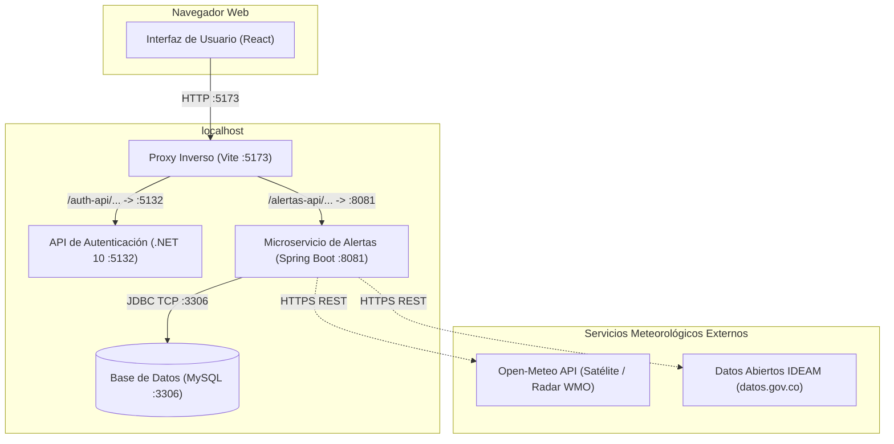
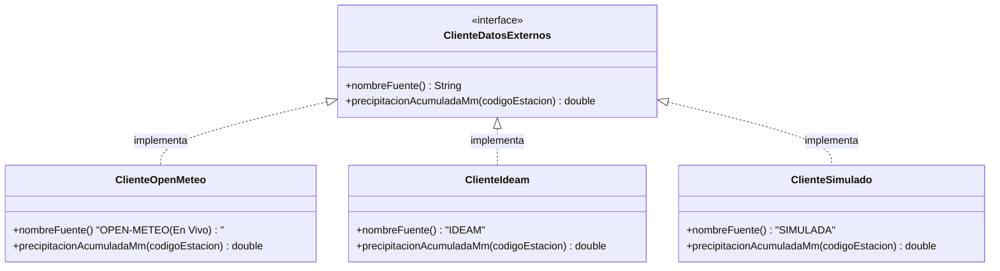
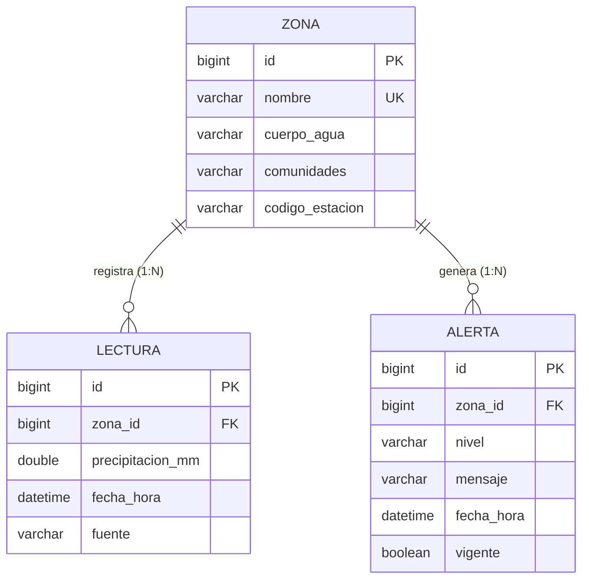
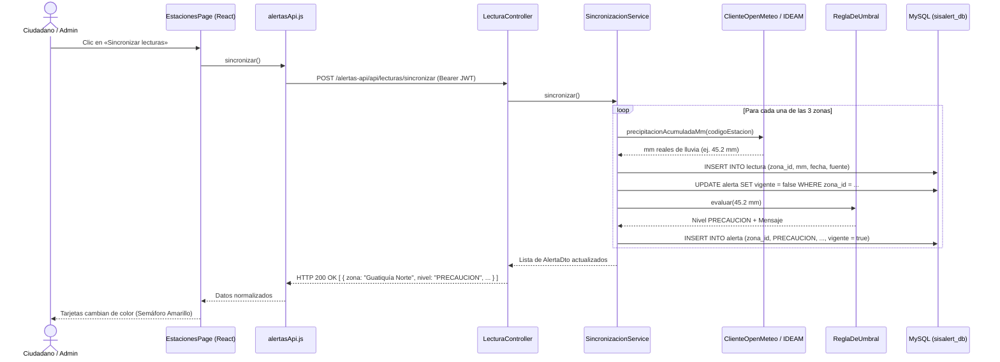

# SisAlert — Manual Técnico y Arquitectura Módulo por Módulo

**Proyecto:** Sistema de Alertas Tempranas de Crecientes — Villavicencio  
**Asignatura:** Telemática 1 · Parcial I · Universidad de los Llanos  
**Fecha:** Noviembre 2026  
**Ubicación en el repositorio:** `docs/manual-tecnico-modulos.md`

---

## 1. Visión General del Sistema

SisAlert es un sistema distribuido orientado a microservicios diseñado para el monitoreo de riesgo por crecientes súbitas en los ríos y caños del municipio de Villavicencio. 

El sistema opera mediante **tres procesos independientes** desacoplados, comunicados estrictamente mediante HTTP/REST y JSON:



### ¿Por qué esta arquitectura?
1. **Desacoplamiento de responsabilidades:** La identidad del usuario (seguridad) vive en una API (.NET), la lógica hidrológica de alertas vive en otro microservicio (Spring Boot), y la presentación vive en el cliente (React).
2. **Solución a CORS mediante Proxy Inverso:** El navegador solo se conecta al puerto `5173`. El servidor de Vite reenvía las peticiones a `:5132` o `:8081`, evitando restricciones de origen cruzado en el navegador.

---

## 2. Microservicio de Alertas (`alertas-service`)

Construido en **Java 17/21** con **Spring Boot 3.5**, **Spring Data JPA** y **MySQL 8.x**. Su responsabilidad exclusiva es gestionar las zonas de riesgo, almacenar lecturas meteorológicas, evaluar los umbrales de alerta y exponer la API REST.

Organización interna por capas:

```
co.edu.unillanos.sisalert.alertas/
├── client/         # Integración con fuentes meteorológicas externas
├── config/         # Precarga de datos y configuración CORS
├── controller/     # Endpoints HTTP REST
├── dto/            # Objetos de transferencia de datos
├── exception/      # Manejo global de excepciones (HTTP 502)
├── model/          # Entidades JPA (Mapeo a tablas MySQL)
├── repository/     # Interfaces de acceso a datos (Spring Data JPA)
├── rules/          # Reglas de negocio puras (Umbrales de semáforo)
├── security/       # Extracción e inspección del token JWT
└── service/        # Lógica de aplicación y orquestación transaccional
```

---

### 2.1 Capa de Modelo (`model/`)

Define las tablas de la base de datos relacional mediante anotaciones JPA (`@Entity`).

| Archivo | Qué hace | Por qué lo hace |
|---|---|---|
| `Zona.java` | Representa una cuenca o sector geográfico de Villavicencio (`id`, `nombre`, `cuerpoAgua`, `comunidades`, `codigoEstacion`). | Separa la ubicación física y comunidades de las mediciones temporales. El nombre es único para evitar duplicidades. |
| `Lectura.java` | Registro inmutable de precipitación (`id`, `zona`, `precipitacionMm`, `fechaHora`, `fuente`). | Almacena los hechos meteorológicos medidos. **Nunca se edita ni se borra**, lo que garantiza auditoría histórica de las lluvias. |
| `Alerta.java` | Almacena el nivel de alerta calculado (`id`, `zona`, `nivel`, `mensaje`, `fechaHora`, `vigente`). | Representa el estado de alerta del sistema. Posee la bandera booleana `vigente` para saber cuál es la alerta actual de la zona. |
| `NivelAlerta.java` | Enumeración: `NORMAL`, `PRECAUCION`, `PELIGRO`. | Tipado estricto que evita inconsistencias de texto y define los 3 estados del semáforo. |

---

### 2.2 Capa de Reglas de Negocio (`rules/`)

Aísla la lógica matemática y de decisión del sistema del resto de la infraestructura.

| Archivo | Qué hace | Por qué lo hace |
|---|---|---|
| `ReglaDeUmbral.java` | Convierte milímetros de lluvia acumulada en un `NivelAlerta` y asigna el mensaje preventivo para el ciudadano. | **Principio de Responsabilidad Única (SRP):** No consulta bases de datos ni servicios web; es una función matemática pura fácil de probar con tests unitarios. Lee los umbrales (`40 mm` y `80 mm`) de `application.properties` para poder cambiarlos sin recompilar. |

---

### 2.3 Capa de Clientes Externos (`client/`)

Aplica el **Patrón Estrategia (Strategy)** y el principio de Inversión de Dependencias (DIP) de SOLID.



| Archivo | Qué hace | Por qué lo hace |
|---|---|---|
| `ClienteDatosExternos.java` | Interfaz que define el contrato: `nombreFuente()` y `precipitacionAcumuladaMm()`. | Permite cambiar de proveedor meteorológico sin modificar una sola línea del servicio ni de la base de datos. |
| `ClienteOpenMeteo.java` | Consulta satélites y radares de la OMM (WMO / ECMWF) para las coordenadas exactas de las 3 zonas de Villavicencio. | Provee **datos verídicos en tiempo real**, con tiempo de respuesta < 200 ms, alta disponibilidad y sin límite estricto de claves. Se activa con `alertas.fuente=open-meteo`. |
| `ClienteIdeam.java` | Consulta la API de Datos Abiertos de Colombia (`datos.gov.co`, dataset `s54a-sgyg`). | Provee conexión oficial con las estaciones telemétricas del IDEAM mediante consultas SoQL. Se activa con `alertas.fuente=ideam`. |
| `ClienteSimulado.java` | Genera lecturas aleatorias controladas entre 0 y 90 mm. | Funciona como **modo de respaldo / demostración** si no hay acceso a internet durante la sustentación. Se activa con `alertas.fuente=simulada`. |

---

### 2.4 Capa de Servicio (`service/`)

Orquesta el flujo de negocio y garantiza la integridad de los datos.

| Archivo | Qué hace | Por qué lo hace |
|---|---|---|
| `SincronizacionService.java` | Ejecuta el flujo principal: 1. Consulta la fuente externa para cada zona. 2. Guarda la `Lectura`. 3. Invalida la alerta anterior (`vigente = false`). 4. Evalúa umbrales y guarda la nueva `Alerta` vigente. | Anotado con `@Transactional`: Si la fuente externa falla a mitad del proceso, **hace rollback automático**: no se guardan lecturas incompletas ni se alteran las alertas previas. |
| `MonitoreoAutonomoTask.java` | **Daemon 24/7 de monitoreo en segundo plano:** Ejecuta periódicamente (`@Scheduled`, cada 60 s en demo) la sincronización de las estaciones sin intervención humana. | Transforma a SisAlert en un verdadero Sistema de Alertas Tempranas preventivo. Si ocurre una creciente en la madrugada, el sistema detecta el riesgo y genera la alerta roja automáticamente aunque ningún usuario esté frente a la pantalla. |
| `AlertaService.java` | Consulta las alertas vigentes actuales de todas las zonas y las convierte a `AlertaDto`. | Permite que el tablero consulte rápidamente el estado actual sin ejecutar una nueva sincronización. |
| `ZonaService.java` | Lista las zonas registradas en el catálogo. | Separa la administración de zonas de la lógica de alertas. |

---

### 2.5 Capa de Controladores y Excepciones (`controller/` y `exception/`)

| Archivo | Qué hace | Por qué lo hace |
|---|---|---|
| `LecturaController.java` | Expone `POST /api/lecturas/sincronizar`. | Permite disparar la sincronización bajo demanda desde el botón del frontend y registra en el log el usuario que lo solicitó. |
| `AlertaController.java` | Expone `GET /api/alertas`. | Devuelve el semáforo y estado actual de cada zona para el polling de la interfaz. |
| `ZonaController.java` | Expone `GET /api/zonas`. | Retorna la lista de cuencas y comunidades. |
| `ManejadorErrores.java` | Captura `FuenteExternaException` con `@RestControllerAdvice`. | Traduce caídas de las APIs meteorológicas a un código HTTP `502 Bad Gateway` estructurado con JSON limpio, evitando que el servidor lance errores 500 no controlados. |
| `UsuarioToken.java` | Decodifica el token JWT en Base64 para extraer el nombre de usuario (`admin`). | Brinda trazabilidad y auditoría de quién ejecutó la sincronización sin acoplar el microservicio a la validación de llaves criptográficas de la API .NET. |

---

## 3. Frontend (`frontend/`)

Desarrollado en **React 19** con **Vite**, componentes funcionales y React Router DOM. Diseñado bajo el principio de **Cliente Delgado (Thin Client)**: no contiene lógica de umbrales ni calcula niveles; solo presenta los datos calculados por el microservicio.

```
frontend/src/
├── api/            # Clientes HTTP y normalizadores de datos
├── components/     # Layout, Navbar, Rutas Protegidas y Chips
├── context/        # Manejo de estado global de autenticación
├── pages/          # Vistas (Login, Registro, Tablero, Alertas)
└── utils/          # Formateadores de fecha y unidades
```

---

### 3.1 Clientes de Comunicación (`src/api/`)

| Archivo | Qué hace | Por qué lo hace |
|---|---|---|
| `apiClient.js` | Función `apiFetch` centralizada. Adjunta automáticamente `Authorization: Bearer <token>`, intercepta respuestas 401 (redireccionando a `/login`) y limpia respuestas de error. | Evita repetir cabeceras en cada llamada y oculta páginas HTML o stack traces crudos del servidor para que el usuario solo vea mensajes legibles. |
| `alertasApi.js` | Funciones `getAlertas()` y `sincronizar()`. Normaliza los estados del backend a clases CSS (`verde`, `amarillo`, `rojo`, `sin-datos`). | Si el backend está apagado y está activado el modo demostración, conmuta a `alertasMock.js`. Si ocurre un error 502 de fuente externa, lo propaga para mostrar la alerta en rojo en pantalla. |
| `authApi.js` | Funciones `login()` y `register()` contra `/auth-api/api/auth`. | Traduce respuestas no estándar de la API de identidad (como HTTP 500 por credenciales erróneas) a mensajes amigables como *"Usuario o contraseña incorrectos"*. |
| `alertasMock.js` | Mock en memoria con las 3 zonas reales y umbrales 40/80 mm. | Permite que el frontend sea probado de forma autónoma sin backend si fuera necesario. |

---

### 3.2 Vistas y Componentes (`src/pages/` y `src/components/`)

| Archivo | Qué hace | Por qué lo hace |
|---|---|---|
| `LoginPage.jsx` | Formulario de acceso ciudadano. Guarda el JWT en `sessionStorage` y navega a `/estaciones`. | Puerta de entrada segura al sistema. |
| `EstacionesPage.jsx` | **Tablero Principal:** Muestra una tarjeta por cada una de las 3 zonas con su indicador de semáforo. Consulta `GET /api/alertas` cada 5 segundos y contiene el botón **«Sincronizar lecturas»**. | Es el centro de monitoreo en tiempo real. Si las alertas están en gris, indica que el sistema arrancó en limpio y requiere sincronizar. |
| `AlertasPage.jsx` | **Vista de Alertas Activas:** Filtra y ordena las zonas que están en `PRECAUCION` o `PELIGRO` (las más críticas primero). | Permite a los organismos de socorro y a la comunidad ver de inmediato dónde hay peligro inminente de desbordamiento. |
| `BannerEmergencia.jsx` | **Banner de Alerta Crítica y Evacuación:** Franja roja parpadeante que se activa automáticamente si alguna cuenca entra en nivel `PELIGRO` (≥ 80 mm). Despliega teléfonos de auxilio de Villavicencio (Bomberos 119, Cruz Roja 132, Defensa Civil 144) y puntos de encuentro seguros del POMCA. | Protege la vida del ciudadano. En un SAT real, el usuario no solo debe saber que hay peligro, sino qué protocolo de evacuación seguir y a quién llamar. |
| `MapaVillavicencio.jsx` | **Centro de Georreferenciación en Vivo:** Integra un mapa satelital/cartográfico interactivo mediante **Leaflet / OpenStreetMap** con marcadores telemétricos en las coordenadas exactas de los 3 sectores de riesgo urbano en Villavicencio (`[4.148, -73.634]` Barzal/Guatiquía Norte, `[4.128, -73.626]` Villacentro/Caño Grande Centro, `[4.075, -73.655]` Catumare/Porfía/Guayuriba Sur). Incluye aros de pulso radar por color del semáforo y popups con detalles hidrológicos. Además, incorpora una **vista de respaldo vectorial offline** con el trazado del río Guatiquía, río Guayuriba y caño Maizaro. | Brinda conciencia situacional geoespacial inmediata a organismos de socorro y ciudadanos. Permite entender qué zonas están aguas arriba y cuáles están aguas abajo. |
| `RutaProtegida.jsx` | Verifica si existe un token en la sesión; si no existe, redirige automáticamente a `/login`. | Impide que usuarios no autenticados accedan al tablero o a las alertas. |

---

## 4. Base de Datos MySQL (`database/init_mysql.sql`)

La persistencia se ejecuta en **MySQL Server 8.x** bajo el esquema **`sisalert_db`**.



### Reglas de Integridad en Base de Datos:
1. **Claves foráneas con eliminación en cascada (`ON DELETE CASCADE`):** Si se llegase a eliminar una zona, se limpian ordenadamente sus lecturas y alertas asociadas.
2. **Histórico preservado:** Las lecturas nunca se sobreescriben; se insertan como nuevos registros con marca de tiempo.
3. **Control de vigencia:** La tabla `alerta` guarda todas las alertas que ha tenido una cuenca a lo largo del tiempo, pero solo una tiene `vigente = true` a la vez.

---

## 5. Flujo de Ejecución de Extremo a Extremo (Secuencia)

Cuando un usuario autenticado presiona **«Sincronizar lecturas»** en la pantalla del tablero, se ejecuta el siguiente ciclo:



---

## 6. Resumen de Puertos y Servicios

| Servicio | Tecnología | Puerto | Rol |
|---|---|---|---|
| **Frontend** | React 19 + Vite | **5173** | Interfaz de usuario y proxy inverso |
| **Microservicio Alertas** | Spring Boot 3.5 | **8081** | Gestión de cuencas, lectura meteorológica y semáforos |
| **API Autenticación** | ASP.NET Core (.NET 10) | **5132** | Emisión de tokens JWT y registro de usuarios |
| **Base de Datos** | MySQL Server | **3306** | Almacenamiento persistente (`sisalert_db`) |
| **Fuente Meteorológica** | Open-Meteo / IDEAM | **443 (HTTPS)** | Proveedor de mediciones pluviométricas en tiempo real |
