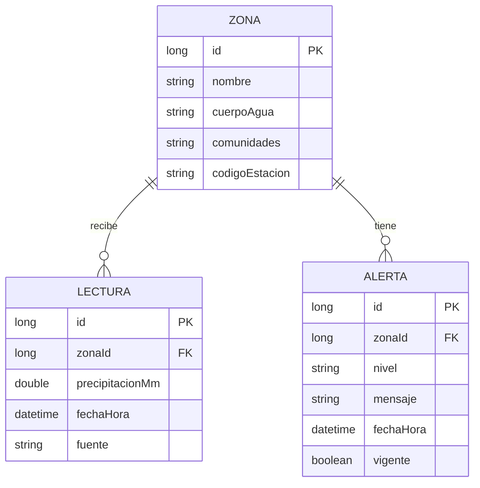

# Diseño del modelo de datos

**Proyecto:** Sistema de Alertas Tempranas de Crecientes — Villavicencio
**Asignatura:** Telemática I · Proyecto final · 2026-II · Universidad de los Llanos
**Ubicación en el repositorio:** `docs/modelo-datos.md`

---

## 1. Objetivo

Definir qué información guarda el microservicio de alertas, cómo se relacionan sus tablas y qué reglas cumplen los datos.

**Alcance:** este documento describe el modelo del microservicio de alertas, persistido en PostgreSQL (tablas `zona`, `lectura` y `alerta`). La API de identidad (`auth-service/`) tiene su propio modelo en la misma base: `usuarios`, `roles`, `permisos`, `usuarios_roles` y `roles_permisos`, gestionado con EF Core. El microservicio de alertas no guarda ni lee usuarios.

---

## 2. Diagrama entidad-relación



Lectura del diagrama: una zona puede tener muchas lecturas y muchas alertas (a lo largo del tiempo); cada lectura y cada alerta pertenece a una sola zona.

---

## 3. Descripción de las tablas

### 3.1 ZONA

Sector de la ciudad asociado a un río o caño, con las comunidades que se ven afectadas y la estación meteorológica que se usa como referencia.

| Columna | Tipo | Obligatoria | Descripción |
|---|---|---|---|
| `id` | Long | Sí | Identificador, generado automáticamente |
| `nombre` | Texto (100) | Sí | Nombre de la zona. Único |
| `cuerpoAgua` | Texto (100) | Sí | Río o caño que genera el riesgo |
| `comunidades` | Texto (255) | Sí | Barrios o comunidades cercanas, separados por comas |
| `codigoEstacion` | Texto (50) | Sí | Código de la estación de referencia en la fuente de datos |

### 3.2 LECTURA

Dato de precipitación obtenido de la fuente externa para una zona en un momento dado. Es un registro histórico: **nunca se modifica**, solo se agregan lecturas nuevas.

| Columna | Tipo | Obligatoria | Descripción |
|---|---|---|---|
| `id` | Long | Sí | Identificador, generado automáticamente |
| `zonaId` | Long | Sí | Zona a la que pertenece (clave foránea a `ZONA`) |
| `precipitacionMm` | Decimal | Sí | Lluvia acumulada del día, en milímetros. Debe ser mayor o igual a 0 |
| `fechaHora` | Fecha y hora | Sí | Momento en que se sincronizó la lectura (la fuente entrega el acumulado del día, no la hora de la medición) |
| `fuente` | Texto (50) | Sí | Nombre de la fuente de datos (por ejemplo, IDEAM) |

### 3.3 ALERTA

Resultado de evaluar la lectura de una zona con la regla de umbral.

| Columna | Tipo | Obligatoria | Descripción |
|---|---|---|---|
| `id` | Long | Sí | Identificador, generado automáticamente |
| `zonaId` | Long | Sí | Zona a la que pertenece (clave foránea a `ZONA`) |
| `nivel` | Texto (20) | Sí | `NORMAL`, `PRECAUCION` o `PELIGRO` |
| `mensaje` | Texto (255) | Sí | Mensaje para el ciudadano asociado al nivel |
| `fechaHora` | Fecha y hora | Sí | Momento en que se generó la alerta |
| `vigente` | Booleano | Sí | `true` si es la alerta actual de la zona; `false` si fue reemplazada |

---

## 4. Relaciones e integridad

| Relación | Cardinalidad | Regla |
|---|---|---|
| ZONA → LECTURA | Uno a muchos | No puede existir una lectura sin zona |
| ZONA → ALERTA | Uno a muchos | No puede existir una alerta sin zona |

Restricciones de la base de datos:

- `ZONA.nombre` es único.
- Las columnas marcadas como obligatorias no admiten valores nulos.
- `LECTURA.precipitacionMm` no puede ser negativa.

---

## 5. Reglas de negocio sobre los datos

1. **Una sola alerta vigente por zona.** Cuando se genera una alerta nueva, la anterior de esa zona pasa a `vigente = false`. Esta regla la aplica el servicio, no la base de datos.
2. **Las lecturas y las alertas no se borran ni se editan** durante la ejecución; así se conserva el recorrido de lo ocurrido mientras el servicio esté encendido.
3. **Una zona sin alerta vigente se muestra como "Sin datos"** en el frontend; no se crea una alerta artificial.
4. **El nivel se guarda como texto** (`NORMAL`, `PRECAUCION`, `PELIGRO`) y no como número, para que sea legible en la base y coincida con lo que recibe el frontend.
5. **Los umbrales de lluvia no se guardan en la base de datos**; se leen de la configuración (`application.properties`).

---

## 6. Datos iniciales

Al arrancar por primera vez, el servicio carga las tres zonas reales de Villavicencio en PostgreSQL. Las lecturas y alertas comienzan vacías. En arranques posteriores `CargaInicial` no duplica nada porque solo siembra si la tabla `zona` está vacía.

| Nombre de la zona | Cuerpo de agua | Comunidades | Código de estación |
|---|---|---|---|
| Zona Guatiquía Norte | Río Guatiquía · Caño Parrado · Caño Gramalote · Quebrada Grande · Quebrada Honda · Caño Buque | Barzal Alto, Barzal Bajo, Siete de Agosto, Villa Lorena, Mancera, La Nohora, El Triunfo | `0035035100` |
| Zona Guayuriba Sur | Río Guayuriba · Caño Rosablanca · Caño La Cuerera | Apiay, Catumare, Playa Rica, La Esperanza, La Nohora Rural, Vanguardia | `3502700090` |
| Zona Caño Grande Centro | Caño Grande · Caño Maizaro · Quebrada La Unión | Porvenir, Bello Horizonte, Villacentro, La Rosita, Marsella, Porfía | `0035025110` |

Las zonas y comunidades corresponden a los sectores con mayor amenaza de inundación según el POMCA del río Guatiquía (CORMACARENA, 2018) y las estaciones telemétricas del IDEAM en el portal de datos abiertos (conjunto `s54a-sgyg`).

---

## 7. Correspondencia con el código

Cada tabla se representa con una entidad JPA en el paquete `model` del microservicio. Ejemplo de la entidad `Alerta`:

```java
@Entity
public class Alerta {

    @Id
    @GeneratedValue(strategy = GenerationType.IDENTITY)
    private Long id;

    @ManyToOne(optional = false)
    private Zona zona;

    @Enumerated(EnumType.STRING)
    @Column(nullable = false, length = 20)
    private NivelAlerta nivel;          // NORMAL, PRECAUCION, PELIGRO

    @Column(nullable = false)
    private String mensaje;

    @Column(nullable = false)
    private LocalDateTime fechaHora;

    @Column(nullable = false)
    private boolean vigente;

    // constructores, getters y setters
}
```

`NivelAlerta` es una enumeración con los tres valores. `Zona` y `Lectura` siguen el mismo patrón.

---

## 8. Configuración de PostgreSQL y migraciones

En `alertas-service/src/main/resources/application.properties`:

```properties
server.port=8081

spring.datasource.url=${DB_URL:jdbc:postgresql://localhost:5432/sisalert}
spring.datasource.username=${DB_USER:sisalert}
spring.datasource.password=${DB_PASSWORD:sisalert}
spring.datasource.driver-class-name=org.postgresql.Driver

spring.jpa.hibernate.ddl-auto=validate
spring.flyway.enabled=true
```

- El esquema lo crea y versiona **Flyway** con los archivos de `src/main/resources/db/migration` (`V1__esquema_inicial.sql`, `V2__crud_zonas.sql`).
- Las tablas viven en el esquema de PostgreSQL **`alertas`**; la API de identidad usa el esquema **`identidad`** en la misma base. Ningún servicio lee las tablas del otro.
- `ddl-auto=validate` hace que Hibernate solo compruebe que las entidades coincidan con las tablas; nunca las modifica.
- Las migraciones se aplican solas al arrancar. La tabla `flyway_schema_history` registra la versión aplicada.
- Las pruebas unitarias usan H2 en memoria (`src/test/resources/application.properties`), así que `mvnw test` no necesita PostgreSQL.
- La API de identidad aplica sus propias migraciones de EF Core sobre las tablas `usuarios`, `roles`, `permisos`, `usuarios_roles` y `roles_permisos` de la misma base.

Los datos viven en el volumen `sisalert-pgdata` del contenedor `sisalert-db`; sobreviven a reinicios del servicio y del contenedor. Solo se pierden si se borra el volumen explícitamente.

---

## 9. Decisiones y justificación

| Decisión | Justificación |
|---|---|
| Tres tablas | Es el mínimo que separa la configuración (zona), el dato medido (lectura) y el resultado (alerta) |
| Lecturas y alertas como registros separados | La lectura es un hecho externo; la alerta es una decisión del sistema. Separarlas permite explicar de dónde salió cada alerta |
| Alertas que se reemplazan, no se actualizan | Conserva lo que ocurrió durante la ejecución sin agregar una tabla de historial |
| `comunidades` como texto simple | Suficiente para el MVP; una tabla de comunidades añadiría complejidad que el alcance actual no pide |
| `nivel` como texto | Legible en la base y compatible con lo que consume el frontend |
| Umbrales fuera de la base de datos | Se ajustan por configuración sin recompilar |
| PostgreSQL con migraciones (Flyway) | Persistencia real, control de versiones del esquema y datos que sobreviven a reinicios |
| Modelo propio del microservicio | Ningún servicio lee los datos de otro; los usuarios quedan en la API de autenticación |

---

## 10. Lista de verificación

- [ ] Diagrama y descripción de tablas revisados por quien construye el microservicio
- [ ] Campos coherentes con las respuestas JSON de `docs/aplicacion.md`
- [ ] Zonas y estaciones de ejemplo definidas (Paso 4)
- [ ] Entidades JPA creadas a partir de este documento
- [ ] Tablas visibles en PostgreSQL (`docker exec -it sisalert-db psql -U sisalert -d sisalert`)
- [ ] Documento revisado por al menos otro integrante